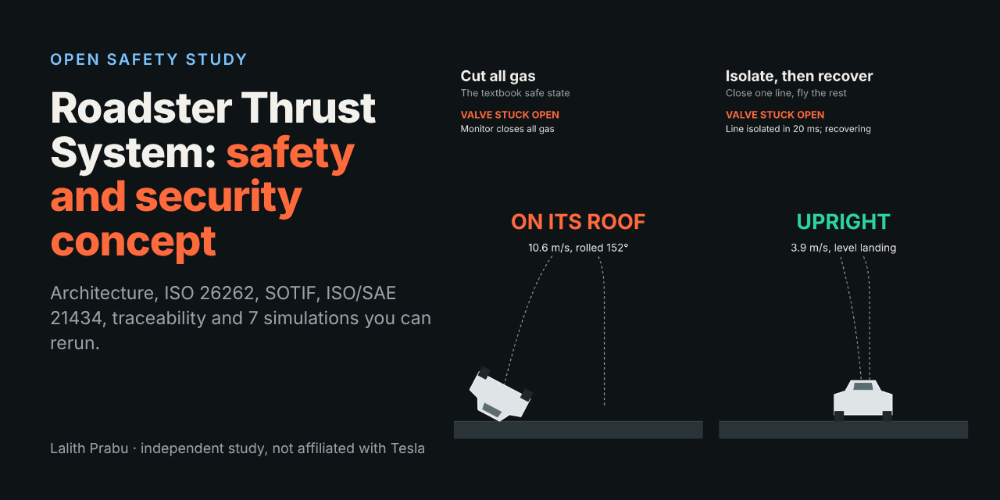
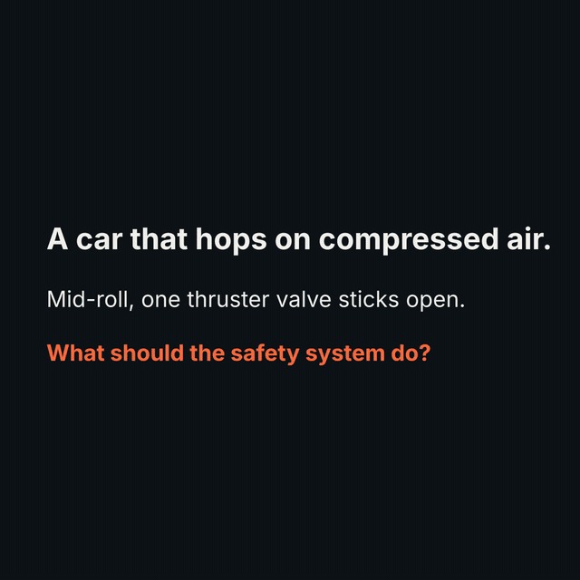
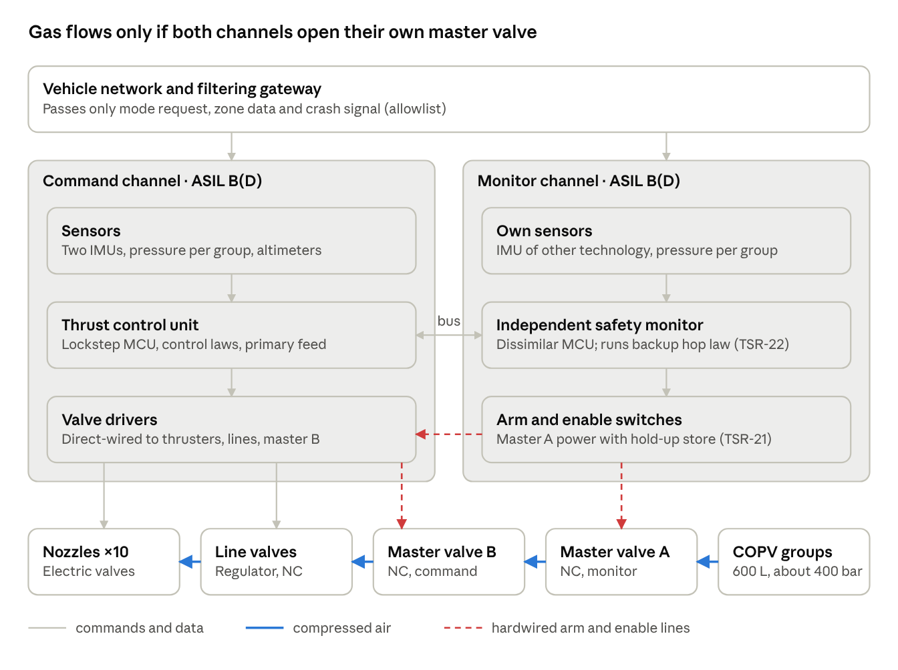
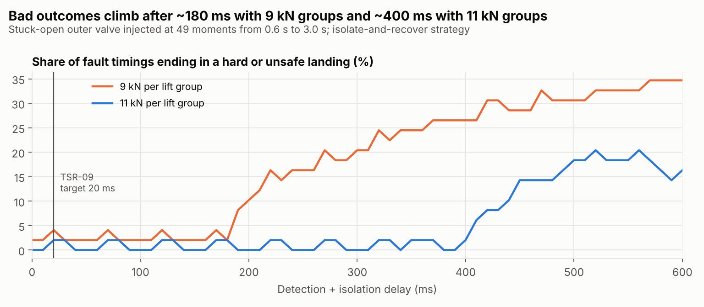
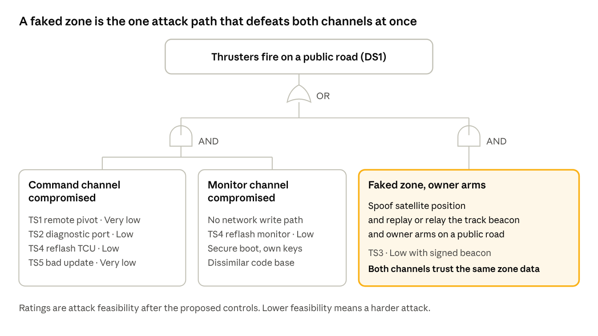

<div align="center">



# Can a car that hops on compressed air ever be made safe?

**An open, independent safety and security study of the cold-gas thruster "hop" revealed on the Tesla Roadster, 15 October 2026.**
Architecture · ISO 26262 · ISO 21448 · ISO/SAE 21434 · 7 simulations you can rerun.

[](https://lalithprabu.github.io/TESLA-Roadster-thrust-safety/viewer/play.html)
[](docs/RTS-SSC-001.pdf)
[](https://lalithprabu.github.io/TESLA-Roadster-thrust-safety/viewer/)
[](sim/)


<br>



<sub>The same stuck-open valve, two safety reactions. Left: the textbook "cut all gas". Right: isolate the line and recover. Simulation 2, played at half speed.</sub>


<br>

### 🎮 [Could you save the Roadster? Test your fault reaction time →](https://lalithprabu.github.io/TESLA-Roadster-thrust-safety/viewer/play.html)
A valve sticks open mid-hop. The car has about 200 ms. The safety computer needs 20 ms. How fast are you?

</div>

> **Not affiliated with, endorsed or reviewed by Tesla or SpaceX.** Tesla has not published the design. Every architecture choice, part, rate and number here is an assumption, registered in Appendix A of the document. See [DISCLAIMER.md](DISCLAIMER.md).

---

## The 60-second version

| | Finding | Evidence |
| :-: | --- | --- |
| 🚗 | **It is a hop, not a flight.** About 244 kg of air at about 400 bar holds a 1,850 kg car in a hover for **6.7 s**. One reference hop uses **55%** of it. | Sim 1 |
| 💥 | **The tanks store about 60 MJ**, roughly **14 kg of TNT** equivalent. "No tank rupture" is ASIL D. | Sim 1 |
| 🔄 | **"Cut all gas" is the wrong safe state in the air.** After a stuck-open valve mid-roll it lands the car on its roof at 10.6 m/s. Isolate and recover lands it upright at 3.9 m/s. | Sim 2 |
| ⏱️ | **About 200 ms** from fault to disaster. Detection and isolation are budgeted at **20 ms**. | Sim 3 |
| ⚠️ | **Fail-safe on the ground is fatal in the air.** Valves that close on power loss drop the car. Hop control must be fail-operational. | TSR-21 to TSR-23 |
| 🔐 | **One faked "you are on a track" signal beats both computers.** An independent zone check in the safety monitor closes it. | TARA, CC-13 |

## The honest verdict

| Safety goal | Target | Result | |
| --- | --- | --- | :-: |
| SG1: no unintended thrust, hardware metrics | ASIL D | SPFM 100%, LFM 98.7%, PMHF 0.006 FIT | ✅ |
| SG6: unsafe landing after a fault, per hop | 1 × 10⁻⁷ | 3.3 × 10⁻⁷ | ❌ |
| SOTIF residual risk with nothing broken, per hop | demonstrated | bounded only at 1.4 × 10⁻³ | ❌ |
| Physical test evidence | required | none | ❌ |

**Promising, not releasable yet.** The document shows exactly what closes each gap.

---

## See the architecture

<div align="center">

<br><sub>Two normally closed master valves in series, each powered by a different computer. One bad computer cannot fire the jets.</sub>
</div>

<br>

<table>
<tr>
<td width="50%" align="center"><br><sub>The clock: about 200 ms to a bad outcome.</sub></td>
<td width="50%" align="center"><br><sub>The attack that beats both channels.</sub></td>
</tr>
</table>

---

## What is inside

| You want | Open |
| --- | --- |
| **The full 47-page document** | [`docs/RTS-SSC-001.pdf`](docs/RTS-SSC-001.pdf) or [`docs/RTS-SSC-001.md`](docs/RTS-SSC-001.md) to read on GitHub |
| **The system architecture** | Chapter 4: logical, functional, E/E, interfaces, modes, timing budget, decision record |
| **To test your own fault reaction time** | [Play the game](https://lalithprabu.github.io/TESLA-Roadster-thrust-safety/viewer/play.html), 30 seconds, no install |
| **To watch the hop and its failures** | [Live fault viewer](https://lalithprabu.github.io/TESLA-Roadster-thrust-safety/viewer/), runs in any browser, nothing to install |
| **The requirements and trace data** | [`data/`](data/), CSV generated from [`tools/requirements_db.py`](tools/requirements_db.py) |
| **The simulation outputs** | [`results/`](results/): charts, JSON, component FMEA, cut sets |

The document covers HARA, safety concept, component FMEA and FMEDA, fault tree, dependent-failure analysis, STPA, SOTIF, TARA, cybersecurity concept, and a verification plan with a safety case.

**By the numbers:** 11 hazardous events · 8 safety goals · 14 FSRs · 23 TSRs · 31 failure modes · 9 threats · 13 controls · 25 verification items.

## Traceability you can check

Most studies stop at a PDF. This one is a connected data set, and a script checks every link on every build.

```
Hazardous event  → Safety goal → FSR → TSR → Architecture element → Verification item → Evidence
Damage scenario  → Threat → Cybersecurity goal → Control → Verification item
```

Every table in the document is generated from [`tools/requirements_db.py`](tools/requirements_db.py). The build stops if [`check_traceability.py`](tools/check_traceability.py) finds a broken link or a residual risk above the limit.

## Reproduce everything

```bash
pip install -r requirements.txt
python sim/run_all.py                # about 1 minute: results/, viewer/index.html and viewer/play.html
python tools/check_traceability.py   # every safety and security link, both directions
python tools/build_docs.py           # docs/RTS-SSC-001.md, .html and .pdf
```

The PDF step uses Playwright with Chromium (`pip install playwright && playwright install chromium`). Use `--no-pdf` to build Markdown and HTML only.

<details>
<summary><b>Repository layout</b></summary>

```
docs/
  RTS-SSC-001.pdf / .md / .html   the consolidated document (generated)
  src/                            chapter sources with {{table:...}} placeholders
  figures/                        architecture, analysis and simulation figures
  assets/                         README banner and animation
data/                             requirements, hazards, TARA, verification (generated CSV)
tools/
  requirements_db.py              single source of truth for every ID and link
  check_traceability.py           checks every link in both directions
  build_docs.py                   fills tables from data, renders MD, HTML and PDF
  figure_roadmap.py               draws the V&V roadmap figure
sim/                              Sims 1-7, shared model, viewer template, run_all.py
results/                          simulation outputs
viewer/index.html                 animated fault viewer (generated)
viewer/play.html                  reaction-time game built on the same simulator (generated)
```
</details>

## Prove me wrong

The most useful thing you can do is find an error. Better failure rates, real component data and flawed assumptions are all welcome.

👉 **[Open an issue](https://github.com/Lalithprabu/TESLA-Roadster-thrust-safety/issues/new)** that names the chapter and the ID (for example `TSR-17` or `A-05`).
If you change an assumption, rerun the three commands above so every table and figure stays consistent.

## Cite this work

GitHub's **"Cite this repository"** button (right-hand side) uses [`CITATION.cff`](CITATION.cff).

## Licence

Code: MIT ([LICENSE](LICENSE)). Documents, figures and data: CC BY 4.0 ([LICENSE-docs.md](LICENSE-docs.md)).
