# Roadster Thrust System: System, Safety and Security Concept

**Document RTS-SSC-001 · Issue 3.0 · 18 October 2026 · Concept phase**

An independent systems-engineering, functional-safety (ISO 26262), SOTIF (ISO 21448) and cybersecurity (ISO/SAE 21434) concept study of a cold-gas-thruster "hop" function on a road sports car, inspired by the Tesla Roadster reveal of 15 October 2026.

> **Disclaimer.** Independent educational analysis. Not affiliated with, endorsed by or reviewed by Tesla, Inc. or SpaceX. Tesla's design is not public: every architecture, part, failure rate and number in this document is an assumption or an estimate derived from public reporting, registered in Appendix A. Nothing here describes the real vehicle, and nothing here is certification evidence. Tesla, Roadster and SpaceX are trademarks of their owners.

## Document control

| Field | Value |
| --- | --- |
| Document | RTS-SSC-001, System, Safety and Security Concept |
| Issue | 3.0 (consolidated and independently reviewed) |
| Status | Concept phase; public release |
| Author | Lalith Prabu |
| Prepared with | AI assistance (Claude by Anthropic); author review before release |
| Data sources of truth | `data/*.csv` (requirements and traceability), `results/` (simulation outputs) |
| Licence | Text, figures and tables CC BY 4.0; code MIT |

## Revision history

| Issue | Date | Change |
| --- | --- | --- |
| 3.0 | 18 Oct 2026 | Consolidated single document set. Added architecture decision record, assumptions register, requirements database with automated link check, independent review record. Updated E/E architecture for fail-operational hop control (TSR-21 to TSR-23). |
| 2.1 | 17 Oct 2026 | Representative component FMEA and FMEDA, traceability chain, factor-scored TARA and attack tree. |
| 2.0 | 16 Oct 2026 | Industry structure: operating domain, functional and E/E architecture, timing budget, ASIL decomposition, DFA, SOTIF acceptance, cybersecurity and V&V. Corrected fill pressure 600 to 400 bar. |
| 1.0 | 16 Oct 2026 | First architecture and safety analysis. |

## How this document maps to the standards

| Chapter | Work product | Standard reference |
| --- | --- | --- |
| 1 | Executive summary | — |
| 2 | Decoded feature and public facts | — |
| 3 | Item definition, concept of operations, operating domain | ISO 26262-3 cl. 5; ISO 21448 cl. 5 |
| 4 | System architecture: logical, functional, E/E, interfaces, modes, timing, design decisions | ISO 26262-4 cl. 6 |
| 5 | Performance and energy budget | — |
| 6 | Hazard analysis and risk assessment, safety goals | ISO 26262-3 cl. 6 |
| 7 | Functional and technical safety concept | ISO 26262-3 cl. 7; ISO 26262-4 cl. 6 |
| 8 | Safety analyses: FMEA, FMEDA, FTA, DFA, STPA | ISO 26262-5 cl. 8–9; ISO 26262-9 cl. 7–8 |
| 9 | SOTIF analysis | ISO 21448 cl. 6–7 |
| 10 | Cybersecurity concept and TARA | ISO/SAE 21434 cl. 9, 15, Annex G |
| 11 | Verification and validation plan | ISO 26262-4 cl. 7–8; ISO 21448 cl. 9–11 |
| 12 | Traceability | ISO 26262-8 cl. 6 |
| 13 | Safety case, regulation, review record, open issues | ISO 26262-2 cl. 6 |
| 14 | Simulation report | Supporting evidence |
| A–B | Assumptions register, sources | — |

## Terms and abbreviations

| Term | Meaning |
| --- | --- |
| ASIL | Automotive safety integrity level, A (lowest) to D (highest); B(D) means ASIL B after decomposition of a D goal |
| CAL | Cybersecurity assurance level (ISO/SAE 21434), 1 to 4 |
| COPV | Carbon-fibre overwrapped pressure vessel |
| DC | Diagnostic coverage |
| DFA | Dependent failure analysis |
| FHA | Functional hazard assessment (aviation, ARP4761A) |
| FIT | Failures in time: one failure per 10⁹ hours |
| FSR, TSR | Functional and technical safety requirement |
| FTTI | Fault tolerant time interval: time from fault to hazard if nothing reacts |
| HIL | Hardware-in-the-loop testing |
| SPFM, LFM, PMHF | Single-point fault metric, latent fault metric, probabilistic metric for hardware failures |
| SOTIF | Safety of the intended functionality: hazards with nothing broken |
| STPA | System-theoretic process analysis |
| TARA | Threat analysis and risk assessment |
| TCU | Thrust control unit (the command-channel computer) |

# 1. Executive summary

The Roadster's "flying" feature is a cold-gas thruster system developed with SpaceX, paired with a fan-driven suction system. It gives powered hops of a few seconds, not sustained flight. This study shows the concept can be made acceptably safe only with four architectural measures: two-channel arming with two master valves in series, a "recover, then cut" response to faults in flight, fail-operational control during a hop, and pre-flight checks of every valve and of the gas reserve.

## Key findings

| # | Finding | Evidence |
| --- | --- | --- |
| 1 | It is a hop, not a flight: about 244 kg of air at about 400 bar holds a 1,850 kg car in a hover for 6.7 s, and one reference hop uses 55% of it | Sim 1 |
| 2 | The gas storage is the largest stored-energy hazard: about 60 MJ of burst energy (about 14 kg TNT), and a full discharge can chill the gas towards −130 °C | Sim 1 |
| 3 | Cutting all gas mid-air is always fatal at hop heights. Isolating only the failed line, then recovering, cut bad outcomes after a stuck-open valve from 100% to 0–3% | Sims 2, 4 |
| 4 | The fault tolerant time interval for a stuck-open valve is about 200 ms; detection and isolation are budgeted at 20 ms | Sim 3 |
| 5 | A stuck-closed valve during the roll (1.10–1.95 s) almost always ends badly; the same fault outside the roll is always safe | Sim 4, viewer |
| 6 | Valves that close on power loss are safe on the ground but drop the car in the air. Three requirements (TSR-21 to TSR-23) make hop control fail-operational | Component FMEA |
| 7 | SG1 (no unintended thrust) meets the ASIL D hardware targets with representative rates: SPFM 100%, LFM 98.7%, PMHF 0.006 FIT. Common-cause faults dominate what risk remains | Sim 7 |
| 8 | A faked track zone is the one attack path that defeats both channels at once, because both trust the same zone data; an independent zone check closes it | TARA, attack tree |
| 9 | Per-hop risk of a bad landing from faults is 3.3 × 10⁻⁷ against a proposed 10⁻⁷ target, and the SOTIF residual is bounded only at 1.4 × 10⁻³ per hop | Sims 4, 6 |
| 10 | There is no regulatory path yet: Tesla lists the Rocket trim as not approved for public road use | Chapter 13 |

## Status at a glance

| Item | Count | State |
| --- | --- | --- |
| Hazardous events | 11 | Rated; 3 at ASIL D |
| Safety goals | 8 | 3 ASIL D, 2 ASIL C, 3 ASIL B |
| Functional safety requirements | 14 | 13 in scope; 1 allocated to the steer-by-wire item |
| Technical safety requirements | 23 | All allocated and with a verification method |
| Verification items | 25 | 11 with analysis or simulation evidence, 2 showing a gap, 12 not started |
| Failure modes analysed | 31 component-level | 23 at action priority H |
| Threat scenarios | 9 | All at risk value 3 or below after 13 controls |
| Traceability check | Safety and security chains, both directions | Passes (`tools/check_traceability.py`) |

## What would block release

1. SOTIF residual risk is not yet demonstrated (G3 in the safety case).
2. Stuck-closed valve authority (TSR-17) and the recovery planner (TSR-20) show gaps in simulation.
3. No physical test evidence exists; every number rests on the assumptions in Appendix A.

# 2. Decoding the feature

Tesla has no single product name for the flying feature. It appears under four names, plus a separate suction system that does the upside-down driving.

| Name | What it refers to | Status |
| --- | --- | --- |
| SpaceX package | Musk's 2018 name for an option with about 10 small thrusters arranged around the car | Public since June 2018 [B8] |
| A71 | Reported internal code name for the Tesla–SpaceX cold-gas thruster system | Reported; not confirmed by Tesla [B6] |
| Thrust trim | "Race ready", 2 seats, rear-mounted cold-gas thrusters for 0–60 mph under 1 s | $250,000 reservation [B1, B2] |
| Rocket trim | "Air ready", 1 seat, 10 thrusters around the car for forward, upward and rotational moves; Tesla says it "can fly" | Invite only; not approved for public road use [B2] |
| Multi-mode suction system | Fans and a ground-sealing skirt that pull air from under the car, strong enough to hold it upside down when stationary | All three trims [B2] |

## What Tesla has disclosed

- 10 thrusters fed by 600 litres of rechargeable compressed air (L. Moravy) [B1]; 250 kg of compressed gas reported by one outlet [B3].
- Every usable void in the car is packed with carbon-fibre overwrapped pressure vessels (COPVs) [B1].
- All-electric actuators make micro-adjustments to stabilise the car in flight [B2].
- Suction allows cornering up to 2G [B3]. 0–60 mph under 1.6 s (Performance), under 0.9 s (Thrust), under 0.59 s (Rocket) [B4, B5].
- Steer-by-wire yoke, Track Mode, magnesium, titanium and carbon-fibre construction [B2].
- The demonstration car was remotely operated with nobody inside. It drove up an inverted ramp, spun and landed, then cleared a Cybercab, Cybertruck, Semi, Model Y and Model 3 [B1].
- Production is planned for 2028 [B1, B2].

Everything else in this document is an assumption, numbered A-01 to A-16 in Appendix A.

# 3. Item definition and concept of operations

## 3.1 Item and boundary

The item is the thrust and suction function: gas supply and storage, distribution, thruster array, suction, the sensing and computers that control them, the arming interface and the protection measures specific to it (subsystems S2–S6 and S8–S11, with their links to S1 and S7). The vehicle platform, steering and airbags are outside the item and appear as interfaces. Thrust functions are allowed only inside a bounded operating domain; everywhere else the car is in Road-safe mode, where thrust is physically impossible.

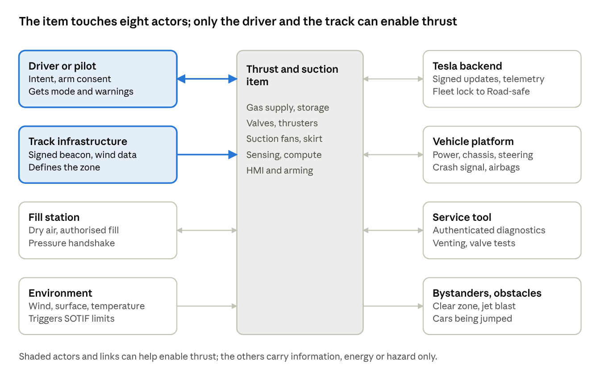

*Figure 1. System context: the item, its eight actors and the only two that can contribute to enabling thrust.*

## 3.2 Use cases

| ID | Use case | Who | Mode | Trim |
| --- | --- | --- | --- | --- |
| UC1 | Normal road driving | Owner | Road-safe | All |
| UC2 | Track driving with suction | Owner | Track | All |
| UC3 | Straight-line boost launch | Owner | Boost | Thrust, Rocket |
| UC4 | Hop or roll manoeuvre | Invited pilot | Hop | Rocket |
| UC5 | Refill the air tanks | Fill-station operator | Road-safe | Thrust, Rocket |
| UC6 | Service, inspect and vent the tanks | Technician | Vent and maintain | Thrust, Rocket |
| UC7 | Crash in any mode | — | Crash | All |
| UC8 | Remote-operated test (development only) | Test engineer | Hop | Prototype |

## 3.3 Operating domain for thrust functions

| Dimension | Allowed | Monitored by |
| --- | --- | --- |
| Location | Authorised track or closed site inside a geofence | Satellite positioning plus signed track beacon |
| People | Nobody inside the clear zone (proposed 50 m for Hop, 20 m for Boost) | Cameras and site procedure |
| Surface | Dry, sealed, paved; no loose gravel | Suction plenum pressure, cameras |
| Wind | Sustained under 8 m/s, gusts under 12 m/s | Site anemometer feed |
| Temperature | −10 to +40 °C ambient | Vehicle sensors |
| Weather | No rain, snow or ice; daylight | Rain sensor, site procedure |
| Occupants | Belted; harness and helmet in Rocket trim | Seat sensors |
| Vehicle state | Gas above reserve; all pre-arm checks passed; no active faults | Mode manager |
| Manoeuvre | Hop apex up to 6 m; Boost in a straight line only | Trajectory planner |

## 3.4 Foreseeable misuse

- Firing thrusters on public roads or in car parks.
- Spoofing or disabling the geofence or beacon (see TS3, TS4 in chapter 10).
- Refilling with wet air, oxygen-enriched air or another gas at an unapproved station.
- Carrying a passenger in the single-seat Rocket trim, or loose cargo during a hop.
- Letting spectators stand inside the clear zone.

# 4. System architecture

The architecture rests on two rules. On the ground, thrust is impossible unless two independent channels agree, so the default state is gas isolated and no thrust. In the air, no single fault may remove thrust, so the car can always level itself and land. The rest of this chapter shows how the subsystems, functions, electronics, interfaces and modes deliver both rules, and why each major design decision was taken. This is a reference architecture inferred from public disclosures; Tesla has not published its own.

## 4.1 Architecture principles

| ID | Principle | Driven by |
| --- | --- | --- |
| P1 | Fail closed on the ground: every gas valve is normally closed and needs active power to open | SG1, SG2 |
| P2 | Fail operational in the air: during a hop no single fault closes the gas or stops control for at least 5 s | SG6 |
| P3 | Two independent, dissimilar channels must both agree before gas can reach a nozzle | SG1 |
| P4 | The thrust domain is isolated: nothing outside it can command thrust | SG1, CG1 |
| P5 | Attitude before altitude: on any in-flight fault, level the car first, then descend | SG6 |
| P6 | Never start what cannot be finished after one fault (gas reserve, lift margin) | SG6 |

## 4.2 Logical architecture

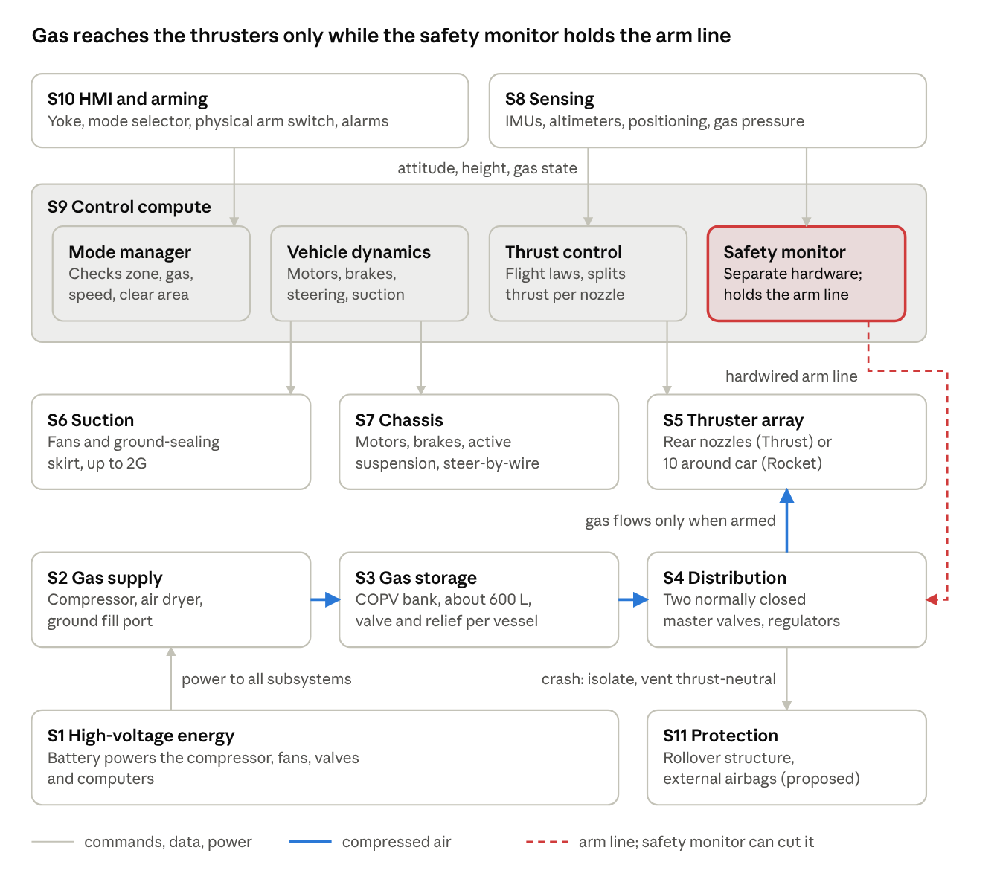

*Figure 2. Logical architecture: eleven subsystems in six layers (energy, gas, effectors, sensing, control, protection), with the gas path and the hardwired arm line.*

| ID | Subsystem | Content | Technical safety requirements allocated |
| --- | --- | --- | --- |
| S1 | High-voltage energy | Battery pack and DC-DC converters powering compressor, fans, valves and compute | TSR-21 |
| S2 | Gas supply | Onboard compressor, air dryer, ground fill port, check valves | TSR-19 |
| S3 | Gas storage | COPV bank (about 600 L at 400 bar), per-vessel isolation and relief, pressure and temperature sensing | TSR-05, TSR-06, TSR-07, TSR-10, TSR-18 |
| S4 | Distribution | Two normally closed master valves in series, regulators, manifold, line valves | TSR-01, TSR-03, TSR-07, TSR-09, TSR-16, TSR-18, TSR-21 |
| S5 | Thruster array | Rear nozzles (Thrust) or 10 perimeter nozzles (Rocket) with fast electric valves and heaters | TSR-09, TSR-15, TSR-16, TSR-17, TSR-18 |
| S6 | Suction | Multi-mode fans, ground-sealing skirt, plenum pressure sensors | TSR-08 |
| S7 | Chassis | Motors, brakes, steer-by-wire, active suspension, active aero | TSR-08 |
| S8 | Sensing | Three IMUs, altimeters, satellite positioning, wheel speeds, cameras | TSR-02, TSR-03, TSR-05, TSR-13 |
| S9 | Control compute | Mode manager, vehicle dynamics controller, thrust control unit, independent safety monitor | TSR-01, TSR-02, TSR-03, TSR-04, TSR-09, TSR-10, TSR-11, TSR-12, TSR-16, TSR-17, TSR-20, TSR-21, TSR-22, TSR-23 |
| S10 | HMI and arming | Yoke, mode selector, physical arm switch, displays and alarms | TSR-02 |
| S11 | Protection | Restraints, rollover structure, external airbags, thrust-neutral emergency venting | TSR-07, TSR-14 |

## 4.3 Functional architecture

Fourteen functions make up the item. Each is allocated to a subsystem and inherits the highest ASIL of the safety goals it supports.

| ID | Function | Allocated to | Supports | ASIL |
| --- | --- | --- | --- | --- |
| F1 | Capture driver intent and arming consent | S10 | SG1 | D |
| F2 | Confirm zone authorisation from two independent sources | S8, S9 | SG1, SG7 | D |
| F3 | Measure gas state and predict usable reserve | S3, S9 | SG2, SG6 | D |
| F4 | Plan the manoeuvre and check it can be finished after one fault | S9 | SG6 | B |
| F5 | Estimate attitude, height and position | S8 | SG6 | B |
| F6 | Compute flight control laws | S9 | SG5, SG6 | C |
| F7 | Allocate thrust to nozzles, torque first | S9 | SG5, SG6 | C |
| F8 | Actuate thruster valves | S5 | SG1, SG5 | D |
| F9 | Isolate gas (master and line valves) | S4, S9 | SG1, SG2, SG6 | D |
| F10 | Monitor, arbitrate and command recovery; run the backup hop law | S9 | SG1, SG6 | D |
| F11 | Generate downforce | S6 | SG4 | C |
| F12 | Protect occupants (restraints, external airbags) | S11 | SG8 | B |
| F13 | Store and refill gas | S2, S3 | SG2 | D |
| F14 | Vent gas without net thrust | S3, S4 | SG2 | D |

## 4.4 E/E and software architecture


*Figure 3. E/E architecture: two channels each own one of the two master valves in series; the monitor also owns the valve-driver supply, the hold-up store and the backup hop law.*

| Element | Command channel | Monitor channel |
| --- | --- | --- |
| Computer | Thrust control unit: lockstep multicore microcontroller | Independent safety monitor: dissimilar microcontroller from a different supplier |
| Software | Partitioned real-time OS: control laws, allocation, recovery planner, diagnostics; separate logging partition | Small bare-metal program: envelope checks, arm logic, recovery command, backup attitude-hold and descent law |
| Sensors | Two IMUs, one pressure sensor per gas group, altimeters | Own IMU of a different technology, own pressure sensor per group |
| Gas valves owned | Master valve B, line and thruster valves (direct-wired) | Master valve A (with hold-up store), enable of all valve-driver supplies |
| Power | Primary low-voltage feed | Secondary feed with local buffer |
| ASIL after decomposition | B(D) for SG1; C for SG5; B for SG6 | B(D) for SG1; B for SG6 recovery and backup control |

**ASIL decomposition of SG1.** SG1 (ASIL D) is decomposed into the command channel at ASIL B(D) and the monitor channel at ASIL B(D). The decomposition is valid only if the dependent failure analysis (section 8.5) shows the channels are sufficiently independent; the FMEDA in section 8.3 shows common cause is the dominant residual, which is why that analysis is decisive.

**Network.** Thrust messages run on a private, authenticated bus between the two channels. The vehicle network can send only a mode request, zone data and the crash signal, through a filtering gateway. No cellular, Wi-Fi or diagnostic path reaches the thrust domain in production.

**Fail-safe and fail-operational hardware.** Every gas valve is normally closed and spring-return, so loss of power on the ground always closes it (P1). In Hop mode, dual-wound coils, a second driver per master valve and a local hold-up energy store keep the master valves open through any single loss for at least 5 s, and closing them in flight takes an explicit command (P2, TSR-21).

## 4.5 Interfaces

| ID | Signal | From → to | Type | Rate | Max latency | ASIL | Protection |
| --- | --- | --- | --- | --- | --- | --- | --- |
| IF-01 | Arm enable A | Safety monitor → master valve A switch | Hardwired, energise-to-open | Continuous | 5 ms to close | B(D) | Dedicated wire, read-back, short detection |
| IF-02 | Arm enable B | Thrust control unit → master valve B switch | Hardwired, energise-to-open | Continuous | 5 ms to close | B(D) | As IF-01 |
| IF-03 | Thrust command | Thrust control unit → valve drivers | Direct-wired, or two independent buses (TSR-23) | 1 kHz | 2 ms | C | Counter, CRC, timeout, authentication |
| IF-04 | Driver enable | Safety monitor → valve-driver supply | Hardwired | Continuous | 5 ms | B(D) | Read-back |
| IF-05 | Zone authorisation | Positioning and beacon → mode manager | Vehicle bus via gateway | 10 Hz | 200 ms | D (two sources) | Two sources must agree; signed beacon; independent check in the monitor (CC-13) |
| IF-06 | Attitude and rates | IMUs → both computers | Private bus or direct SPI | 1 kHz | 2 ms | B | Three-way voting, plausibility |
| IF-07 | Gas pressure and temperature | Sensors → both computers | Analogue or private bus | 500 Hz | 5 ms | D | Two dissimilar sensors per group |
| IF-08 | Suction plenum pressure | Sensors → vehicle dynamics controller | Vehicle bus | 200 Hz | 10 ms | C | Range and rate checks |
| IF-09 | Mode request | HMI → mode manager | Vehicle bus via gateway | Event | 50 ms | D | Physical arm switch plus two-step confirm |
| IF-10 | Crash signal | Airbag controller → both computers | Hardwired plus bus | Event | 10 ms | D | Redundant paths |
| IF-11 | Line isolation command | Thrust control unit → line valves | Direct-wired | Event | 20 ms | B | Read-back of valve position |

## 4.6 Operating modes

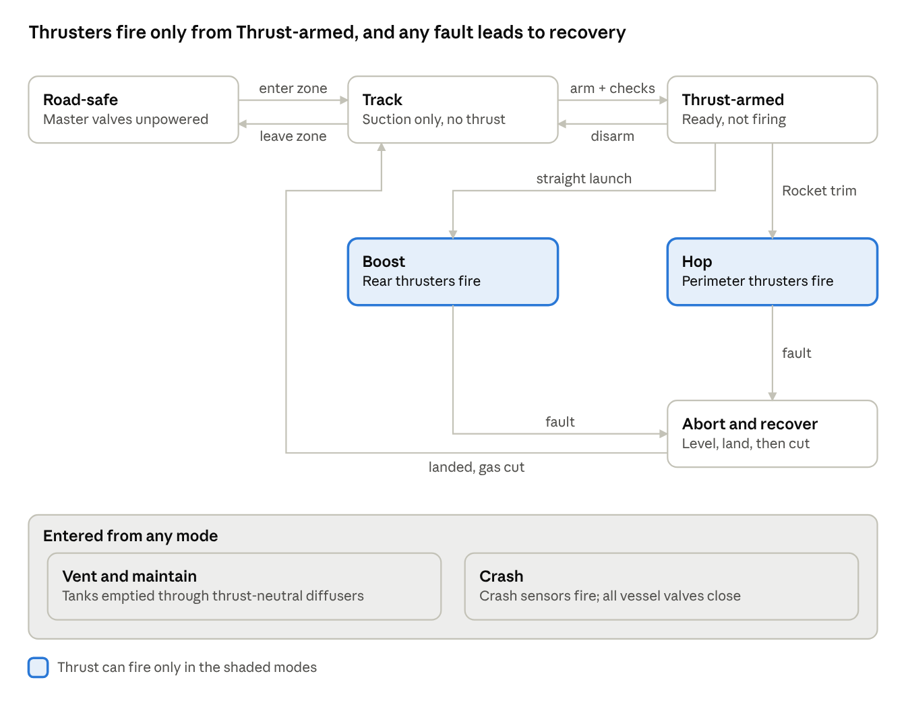

*Figure 4. Operating modes: thrusters can fire only in Boost and Hop, entered only from Thrust-armed; any fault leads to recovery.*

| Mode | Thrust | Entry conditions |
| --- | --- | --- |
| Road-safe | Physically impossible: master valves unpowered | Default at power-on and on public roads |
| Track | No; suction allowed | Driver request inside an authorised track zone |
| Thrust-armed | Ready, not firing | Track mode, physical arm switch, gas reserve check passed, clear zone confirmed |
| Boost | Rear thrusters | Armed, wheels on ground, straight-line launch |
| Hop | Perimeter thrusters | Armed, Rocket trim, manoeuvre passes the reserve and lift-margin checks |
| Abort and recover | Remaining gas used to level the car, then land | Any fault during Boost or Hop |
| Vent and maintain | No; tanks emptied through diffusers | Service, or a fault that needs gas removed |
| Crash | No; all vessel valves closed | Crash sensors fire, in any mode |

## 4.7 Timing budget

The tightest timing is the stuck-open valve in flight: the FTTI is about 200 ms with 9 kN lift groups (Sim 3), against a 20 ms detection-to-isolation budget. For SG1 the safe state is held continuously, so no reaction time applies.

| Goal | Fault | FTTI | Detection | Decision | Actuation | Budget | Basis |
| --- | --- | --- | --- | --- | --- | --- | --- |
| SG6 | Stuck-open thruster valve in flight | 200 ms | 10 ms (line pressure vs command, IMU residual) | 2 ms | 8 ms line valve closes | 20 ms (ceiling 50 ms) | Sim 3 |
| SG6 | Leak or pressure loss in flight | Depends on leak rate | 20 ms (pressure decay vs model) | 2 ms | Next control cycle | 25 ms | Sim 4 |
| SG6 | Thrust control unit lost in flight | Under 200 ms (estimate) | 10 ms (watchdog) | 5 ms | Backup law takes over | 50 ms | TSR-22 |
| SG5 | Asymmetric thrust in launch | About 100 ms (estimate) | 5 ms (yaw rate vs model) | 1 ms | 8 ms master valve closes | 15 ms | Estimate |
| SG4 | Suction loss at high cornering load | About 150 ms (estimate) | 10 ms (plenum pressure) | 5 ms | Speed and cornering limits | 100 ms | Estimate |
| SG2 | Over-pressure while refilling | Seconds | 100 ms | 10 ms | Stop fill; mechanical relief as backup | 1 s | Estimate |

Loop rates: attitude control and allocation 1 kHz; monitor envelope checks 1 kHz; mode manager 100 Hz; zone authorisation 10 Hz.

## 4.8 Architecture decision record

| ID | Decision | Alternatives considered | Rationale | Consequence |
| --- | --- | --- | --- | --- |
| AD-01 | Two normally closed master valves in series, each powered by a different channel | One master valve with redundant drivers | Enables SG1 decomposition into B(D) + B(D); no single valve or driver fault releases gas | Extra valve mass and pressure drop; leak-down test needed to keep faults from going latent |
| AD-02 | Dissimilar safety monitor from a different supplier | Second identical lockstep computer | Reduces common-cause faults, the dominant residual in the FMEDA | Two code bases and tool chains to maintain |
| AD-03 | Recover, then cut, in flight | Cut all gas on any fault | Sim 2: cutting mid-roll lands the car on its roof; recovery lands it upright | Monitor logic must know the flight phase; cutting stays the safe state on the ground |
| AD-04 | Fail-operational hop control: hold-up store, dual-wound coils, backup law | Rely on fail-closed valves | Component FMEA: loss of power or a computer mid-hop otherwise drops the car | More hardware in the monitor channel; must not weaken SG1 on the ground |
| AD-05 | Isolated thrust domain behind an allowlist gateway | Thrust functions on the shared vehicle network | Removes remote attack paths to a severe damage scenario | Updates to the thrust domain only with tanks empty and car present |
| AD-06 | Gas split into at least two vessel groups with own isolation valves | One manifolded bank | A leak or stuck valve costs part of the reserve, not all of it | More valves and sensors |
| AD-07 | Thrust-neutral emergency venting through paired diffusers | Single vent | Venting must not push the car, especially after a crash | Packaging of opposed diffusers |
| AD-08 | Reserve check before every manoeuvre, offering a lower manoeuvre instead of refusing | Fixed minimum fill | Sim 4: without it, 21% of fault-free random hops starve | Availability cost at low fill |
| AD-09 | Monitor confirms the zone independently (inertial dead-reckoning from the last trusted beacon fix) | Both channels use the same zone data | Attack tree: a faked zone otherwise defeats both channels at once | Beacon infrastructure must sign fixes |

# 5. Performance and energy budget

The budget turns the disclosed figures into the physical limits every later chapter depends on. All values come from Sim 1 (chapter 14) using the assumptions in Appendix A; the most sensitive is the fill pressure (A-05), which Tesla has not disclosed.

| Quantity | Value | How it is obtained |
| --- | --- | --- |
| Gas volume | 600 L | Disclosed [B1] |
| Fill pressure | About 400 bar | Assumed (A-05); 600 bar would need a stronger vessel class than reported |
| Gas mass at fill | About 244 kg | Real-gas density at 400 bar, 293 K (compressibility Z ≈ 1.17); consistent with the 250 kg figure in [B3] |
| Weight to hold in a hover | About 18.1 kN | 1,850 kg vehicle (A-01) |
| Specific impulse of the jets | 69 s at fill, falling to 48 s as the gas cools | Ideal nozzle expansion of air from the regulated supply |
| Hover endurance, full tanks | 6.7 s | Adiabatic blowdown until supply pressure falls below the regulator minimum |
| Gas left unusable at the end | About 40 kg | Tank pressure falls to about 28 bar |
| Gas temperature at the end of a full discharge | About 142 K (−131 °C) | Adiabatic expansion in the tanks |
| Reference hop (4.5 m apex, 360° roll, soft landing) | 134 kg, 4.15 s, 55% of the fill | Sim 1, Sim 2 |
| Minimum fill to start the reference hop with a 1.2 reserve factor | 86% | Sim 4 |
| Launch, 0–60 mph in 0.9 s (Thrust trim) | 32–46 kg of gas | Thrust needed beyond tyre grip, 13–19% of the fill |
| Launch, 0–60 mph in 0.59 s (Rocket trim) | 46–67 kg of gas | 19–27% of the fill |
| Stored energy if a full bank bursts | About 60 MJ (about 14 kg of TNT) | Isentropic expansion energy of the stored gas |
| Energy to refill, ideal | About 34 kWh | Isothermal compression; a real compressor needs two to three times more |

**What the budget means for the architecture.**

1. *It is a hop, not a flight.* A full bank gives under seven seconds of hover, and one reference hop uses more than half of it. There is no gas for a second attempt, so the reserve check (TSR-10) and recovery on the remaining gas (TSR-11) are essential, not optional.
2. *The vessels are a stored-energy hazard that can be released in milliseconds*, unlike the battery's chemical energy, which is released over seconds to minutes. SG2 is ASIL D for this reason, and vessel placement, shielding and thrust-neutral venting (AD-07) are architecture decisions, not packaging details.
3. *Cold is a design load.* Valves, seals and liners must work at the coldest gas temperature of a full discharge (TSR-18), and refill air must be dry (TSR-19), or ice can jam a valve when it is needed most.
4. *The car cannot refill itself quickly.* An on-board compressor powered from the traction battery would take far longer than a station refill; the operating concept assumes a fill station at the track (UC5).

# 6. Hazard analysis and risk assessment

## 6.1 Method

Hazardous events are rated with ISO 26262-3 severity (S), exposure (E) and controllability (C) classes. Because a hop is closer to a short flight than to driving, each in-flight failure condition is also classified the aviation way (ARP4761A functional hazard assessment) and given a probability target per hop. Where the two methods disagree, the stricter result governs.

Rating rules used throughout:

- **Severity.** Any event that can kill an occupant or a bystander is S3. A hop from 4.5 m that ends inverted or at more than 5 m/s vertical speed is treated as potentially fatal.
- **Exposure.** Public-road situations are E4. Track use with the thrusters armed is E3 for Boost, which any Thrust-trim owner can use, and E2 for Hop, which needs the invite-only Rocket trim at an authorised site. The inverted-ramp stunt is E1.
- **Controllability.** No driver can correct an unexpected thrust event or an in-flight fault within the time available (C3), except low-speed manoeuvring, where braking can partly help (C2).

## 6.2 Hazardous events

| ID | Hazardous event | Situation | S | E | C | ASIL | Goal |
| --- | --- | --- | --- | --- | --- | --- | --- |
| HE1 | Unintended thruster firing | Driving on a public road | S3 | E4 | C3 | D | SG1 |
| HE2 | Unintended thruster firing | Parking or low speed near people | S3 | E4 | C2 | C | SG1 |
| HE3 | COPV rupture or uncontrolled venting | Any driving or parking | S3 | E4 | C3 | D | SG2 |
| HE4 | Loss of steering | Any driving (steer-by-wire) | S3 | E4 | C3 | D | SG3 |
| HE5 | Sudden loss of suction at high cornering load | Track mode, near 2G | S3 | E3 | C3 | C | SG4 |
| HE6 | Asymmetric thrust during launch | Boost, 3-4.6 g straight-line launch | S3 | E3 | C3 | C | SG5 |
| HE7 | Loss of thrust mid-manoeuvre (gas used up, leak, icing, valve closure) | Hop | S3 | E2 | C3 | B | SG6 |
| HE8 | Stuck-open, stuck-closed or wrong-direction thruster | Hop | S3 | E2 | C3 | B | SG6 |
| HE9 | Jet blast or car strikes a bystander | Hop or Boost with a person in the area | S3 | E2 | C3 | B | SG7 |
| HE10 | Unintended external airbag deployment | Highway driving | S2 | E4 | C2 | B | SG8 |
| HE11 | Loss of suction while inverted | Inverted-ramp stunt | S3 | E1 | C3 | A | SG6 |

## 6.3 Functional hazard assessment for flight phases

| Failure condition | Phase | Effect | Class | Target per hop |
| --- | --- | --- | --- | --- |
| Total loss of thrust | Climb, apex, roll | Fall from up to 6 m, possibly inverted | Catastrophic | Below 10⁻⁷ |
| Uncontained asymmetric thrust | Any airborne phase | Uncontrolled roll; inverted landing | Catastrophic | Below 10⁻⁷ |
| Loss of attitude information | Any airborne phase | Uncontrolled attitude | Catastrophic | Below 10⁻⁷ |
| Single stuck-closed nozzle | Roll | Reduced roll braking; possible overshoot | Hazardous | Below 10⁻⁵ |
| Partial loss of lift | Descent | Hard landing at 3–5 m/s | Major | Below 10⁻³ |
| Lateral drift beyond 3 m | Any | Car leaves the landing area | Major | Below 10⁻³ |

## 6.4 Safety goals

| ID | Safety goal | ASIL | Safe state | FTTI | From |
| --- | --- | --- | --- | --- | --- |
| SG1 | Prevent thrust unless armed in an authorised zone with a valid driver command | D | Master valves closed (Road-safe) | Preventive | HE1, HE2 |
| SG2 | Prevent COPV rupture or uncontrolled venting from harming anyone | D | Vessels isolated; thrust-neutral venting | Seconds (fill over-pressure) | HE3 |
| SG3 | Maintain steering control | D | Redundant steer-by-wire, degraded mode | Per steering item | HE4 |
| SG4 | Prevent a loss of downforce greater than the chassis can handle | C | Speed and cornering limits, warning | About 150 ms (estimate) | HE5 |
| SG5 | Prevent asymmetric thrust during a launch | C | Cut thrust (safe on the ground) | About 100 ms (estimate) | HE6 |
| SG6 | Ensure any started manoeuvre can be finished and landed upright after one fault | B + FHA target 1e-7 per hop | Level the car, land, then cut | 200 ms (Sim 3) | HE7, HE8, HE11 |
| SG7 | Prevent jet blast or the car striking a person | B | Refuse to arm | Preventive | HE9 |
| SG8 | Prevent external airbag deployment outside Hop mode | B | Airbags disarmed | Preventive | HE10 |

## 6.5 Rationale for difficult ratings

**Why SG6 is ASIL B with a quantitative target.** By the ISO 26262 tables, a fatal loss of control during a hop is S3, C3 and E2, which yields ASIL B. That rating reflects how rarely the hop situation occurs across the whole fleet, not how dangerous each hop is. For the person in the car, a hop is a flight. An ASIL B rating on its own would allow a per-hop risk far above what aviation accepts for a catastrophic failure. This study therefore keeps ASIL B for the development process and adds the FHA target of 10⁻⁷ per hop as a quantitative requirement, checked in Sim 6 and section 9.3. If the operator markets the hop as a routine feature (E3 or E4), SG6 rises to ASIL C or D.

**Why HE11 is merged into SG6.** Loss of suction while inverted (ASIL A on its own) has the same safe state as an in-flight fault: level the car and land. It is handled by SG6's recovery requirements.

**Why SG3 is outside the item.** Steering is a separate steer-by-wire item with its own ASIL D goal. It appears here only as an interface; FSR-3.1 records the allocation.

**Why HE1 and HE2 share SG1.** They are the same malfunction in different situations; the goal takes the worse rating (ASIL D).

# 7. Functional and technical safety concept

## 7.1 Functional safety requirements

Each safety goal is refined into functional safety requirements that say *what* the system must do, without naming hardware.

| ID | Functional safety requirement | Goal | ASIL |
| --- | --- | --- | --- |
| FSR-1.1 | Keep the gas path to the nozzles closed unless two independent channels both authorise it | SG1 | D |
| FSR-1.2 | Authorise thrust only with driver consent, an authorised zone confirmed by two independent sources and passed pre-arm checks | SG1 | D |
| FSR-1.3 | Accept thrust commands only from authenticated sources inside the thrust domain | SG1 | D |
| FSR-2.1 | Contain the stored gas under all foreseeable pressure, temperature and impact loads | SG2 | D |
| FSR-2.2 | On crash or fire, isolate every vessel and vent only without net thrust | SG2 | D |
| FSR-3.1 | Maintain steering control (allocated to the steer-by-wire item; outside this item) | SG3 | D |
| FSR-4.1 | Detect loss of downforce and limit speed and cornering before grip is exceeded | SG4 | C |
| FSR-5.1 | Detect asymmetric thrust during a launch and stop it | SG5 | C |
| FSR-6.1 | Start a manoeuvre only when the remaining gas can finish it after one fault | SG6 | B |
| FSR-6.2 | Respond to any in-flight fault with recovery to an upright landing, never with loss of all thrust | SG6 | B |
| FSR-6.3 | Isolate a faulty thruster path and compensate with the others | SG6 | B |
| FSR-6.4 | Estimate attitude, height and gas state with tolerance to one sensor fault | SG6 | B |
| FSR-7.1 | Refuse to arm unless the clear zone is empty and wind is within limits | SG7 | B |
| FSR-8.1 | Arm external airbags only in Hop mode above 1.5 m | SG8 | B |

## 7.2 Safety mechanisms

| Mechanism | Detects | Reaction | Goal | Covered by |
| --- | --- | --- | --- | --- |
| Two-channel arming with master valves in series | Wrong arming decision by either computer | The other channel's valve stays closed | SG1 | TSR-01, TSR-02 |
| Power-on leak-down test of master valves | Latent stuck-open or leaking master valve | Thrust locked out | SG1, SG2 | TSR-03 |
| Pre-arm valve function test | Stuck-open or stuck-closed thruster, line or master valve | Arming refused | SG1, SG6 | TSR-16 |
| Line pressure against command, IMU residual | Stuck-open thruster valve in flight | Line isolated within 20 ms, others compensate | SG5, SG6 | TSR-09, TSR-15 |
| Gas reserve prediction | Too little gas to finish after one fault | Lower manoeuvre offered or recovery started | SG6 | TSR-10, TSR-11 |
| Monitor envelope check | Attitude, rate or height outside the planned envelope | Recovery commanded, not gas cut | SG6 | TSR-12, TSR-20 |
| IMU voting with dissimilar check | Single attitude-sensor fault | Faulty sensor masked | SG6 | TSR-13 |
| Fail-operational hop hardware | Power, coil, switch or computer loss mid-hop | Master valves held open; backup law takes over | SG6 | TSR-21, TSR-22, TSR-23 |
| Plenum pressure monitoring | Suction loss | Speed and cornering limits, warning | SG4 | TSR-08 |
| Crash isolation | Crash or fire | All vessel valves close; thrust-neutral venting | SG2 | TSR-07 |
| Dual dissimilar pressure sensing | Pressure sensor fault | Faulty reading masked; fill or hop refused | SG2, SG6 | TSR-05 |
| Fill-coupling dew-point check | Wet refill air | Fill refused | SG2 | TSR-19 |
| Airbag arming window | Deployment outside Hop mode | Airbags stay disarmed | SG8 | TSR-14 |

## 7.3 Degradation and warning concept

| Situation | System response | Driver information |
| --- | --- | --- |
| Any fault detected on the ground | Road-safe mode; thrust locked out until service | Warning; thrust functions greyed out |
| Gas below reserve before a hop | Lower manoeuvre offered | Message with the largest manoeuvre available |
| Fault during Boost | Thrust cut; car stays on its wheels | Warning |
| Fault during a hop | Recover with remaining gas: level first, then descend and land | Recovery indicator; harness pre-tension |
| Second fault during recovery | Backup law holds attitude and descends; external airbags armed | As above |
| Suction loss in Track mode | Speed and cornering limits within 100 ms | Warning |

## 7.4 Technical safety requirements

Technical safety requirements say *how*, allocate each function to an architecture element of chapter 4 and name the verification item that will prove it. They are generated from the requirements database (`data/technical_safety_requirements.csv`).

| ID | Technical safety requirement | ASIL | From | Allocated to | Verified by |
| --- | --- | --- | --- | --- | --- |
| TSR-01 | Two normally closed master valves in series: valve A powered only by the safety monitor, valve B only by the thrust control unit | B(D) + B(D) | FSR-1.1 | S4, S9, IF-01, IF-02 | VER-01 |
| TSR-02 | Arming requires Track mode, a physical arm switch, zone authorisation from two independent sources, speed and wind within limits, belts fastened and a clear zone | D | FSR-1.2, FSR-7.1 | S8, S9, S10, IF-05, IF-09 | VER-02, VER-20 |
| TSR-03 | A leak-down test of the master valves runs at every power-on; a failure locks out thrust | D | FSR-1.1 | S4, S8, S9 | VER-01 |
| TSR-04 | Thrust messages are authenticated; production cars have no remote thrust path | D | FSR-1.3 | S9, IF-03 | VER-03, VER-21 |
| TSR-05 | Pressure is measured by two dissimilar sensors per gas group, with temperature compensation | D | FSR-6.4, FSR-2.1 | S3, S8, IF-07 | VER-04 |
| TSR-06 | COPVs meet a burst ratio of 2.25 or more and pass pressure-cycling, fire, drop and impact tests equivalent to UN GTR 13 | Design standard | FSR-2.1 | S3 | VER-05 |
| TSR-07 | On crash detection all vessel valves close within 50 ms; venting only through thrust-neutral diffusers away from the cabin | D | FSR-2.2 | S3, S4, S11, IF-10 | VER-06 |
| TSR-08 | Loss of suction is detected from plenum pressure and speed and cornering limits apply within 100 ms, with a warning | C | FSR-4.1 | S6, S7, IF-08 | VER-07 |
| TSR-09 | A stuck-open thruster valve is detected and its line isolated within 20 ms (hard ceiling 50 ms) | B | FSR-5.1, FSR-6.3 | S4, S5, S9, IF-11 | VER-08 |
| TSR-10 | A hop starts only if usable gas is at least 1.2 times the predicted need, corrected for mass and gas temperature; otherwise a lower manoeuvre is offered | B | FSR-6.1 | S3, S9 | VER-09 |
| TSR-11 | If predicted gas at landing falls below the reserve mid-manoeuvre, recovery starts at once: level attitude first, then land | B | FSR-6.2 | S9 | VER-10 |
| TSR-12 | While airborne the safety monitor commands recovery instead of closing the master valves, unless thrust itself is the uncontainable fault | B | FSR-6.2 | S9 | VER-11 |
| TSR-13 | Attitude comes from three IMUs with voting; the monitor checks it with a dissimilar sensor | B | FSR-6.4 | S8, IF-06 | VER-12 |
| TSR-14 | External airbags arm only in Hop mode above 1.5 m and are disarmed by two independent signals on landing | B | FSR-8.1 | S11 | VER-13 |
| TSR-15 | After isolating any one lift group, the remaining torque-balanced groups lift at least 1.1 times maximum vehicle weight (about 10 kN per group) | B | FSR-6.3 | S5 | VER-14 |
| TSR-16 | Before every arming each thruster, line and master valve is cycled against a pressurised test volume; coverage of stuck-open and stuck-closed faults at least 99.9% | D | FSR-1.1, FSR-6.3 | S4, S5, S9 | VER-15 |
| TSR-17 | Any single stuck-closed nozzle leaves at least 50% of nominal roll-braking authority (individually controlled nozzles) | B | FSR-6.3 | S5, S9 | VER-16 |
| TSR-18 | COPVs, valves and seals are qualified to the lowest gas temperature of a full discharge, or discharge is limited to their qualified temperature | D | FSR-2.1 | S3, S4, S5 | VER-17 |
| TSR-19 | Refill air is dried to a dew point below -40 C, checked at the coupling; otherwise the fill is refused | D | FSR-2.1 | S2 | VER-18 |
| TSR-20 | The recovery planner chooses the upright attitude reachable with the least altitude loss, using the predicted stopping angle | B | FSR-6.2 | S9 | VER-19 |
| TSR-21 | In Hop mode no single loss of power, coil, switch or computer closes a master valve for at least 5 s (dual-wound coils, second driver, hold-up energy); closing in flight needs an explicit command | B | FSR-6.2 | S1, S4, S9 | VER-22 |
| TSR-22 | Hop-mode control is fail-operational for at least 5 s: a backup attitude-hold and descent law on independent hardware takes over within 50 ms | B | FSR-6.2 | S9 | VER-23 |
| TSR-23 | Thruster and line valve commands are direct-wired or carried on two independent buses; a lost command opens nothing new | B | FSR-6.2 | S9, IF-03, IF-11 | VER-24 |

# 8. Safety analyses

Five analyses check the architecture from different directions: the FMEA works up from component failures, the fault tree works down from the worst outcome, the FMEDA puts numbers on the hardware, the dependent failure analysis looks for faults that defeat both channels at once, and STPA looks for unsafe control decisions with nothing broken.

## 8.1 Subsystem FMEA

| Subsystem | Failure mode | Worst effect | Main safety mechanism | Goal |
| --- | --- | --- | --- | --- |
| S2 Compressor and fill | Over-pressure; wet air | Vessel overload; ice in valves | Fill limit plus mechanical relief; dew-point check | SG2 |
| S3 Gas storage | Rupture; leak | Blast; loss of reserve in flight | Burst ratio, shielding; pressure decay monitor | SG2, SG6 |
| S4 Distribution | Master or line valve stuck open or closed | Unintended thrust; loss of a lift group | Series masters; pre-arm test; line isolation | SG1, SG6 |
| S5 Thrusters | Valve stuck open, stuck closed or slow | Asymmetric thrust | Line isolation and compensation | SG5, SG6 |
| S6 Suction | Fan or skirt failure | Sudden loss of downforce | Plenum pressure monitoring, limits | SG4 |
| S8 Sensing | IMU, pressure or positioning error | Wrong control or wrong zone | Voting, dissimilar checks | SG1, SG6 |
| S9 Control | Wrong command; computer lost | Unintended thrust; loss of control | Two channels; backup hop law | SG1, SG6 |
| S10 HMI and arming | Stuck arm switch; false request | Arming without consent | Two-step confirm plus physical switch | SG1 |
| S11 Protection | Airbag fires on the road | Driver startled; loss of view | Arming window, two disarm signals | SG8 |

## 8.2 Component design FMEA

The component FMEA uses the AIAG-VDA method: severity (S), occurrence (O) and detection (D) are each rated 1–10 and combined into an action priority (H, M or L) from the AIAG-VDA table. Parts are representative types, not Tesla's parts (A-11). Of 31 failure modes, 23 are at action priority H. That is expected at concept stage, because most modes have S = 9 or 10 and design verification does not yet exist. The table below is generated from `results/component_fmea.csv`.

| Component | Failure mode | Effect | S | O | D | AP | Goal | Field diagnostic | DC % |
| --- | --- | --- | --- | --- | --- | --- | --- | --- | --- |
| COPV (Type IV, ~100 L, 400 bar) | Rupture | Blast and fragments | 10 | 3 | 2 | L | SG2 | Impact log, pressure-rate monitor | 60 |
| COPV (Type IV, ~100 L, 400 bar) | Liner or boss leak | Gas loss; reserve error in flight | 9 | 4 | 3 | H | SG6 | Pressure decay vs model | 95 |
| Pressure relief device (burst disc + thermal) | Opens early | Uncontrolled vent; possible net thrust | 8 | 4 | 3 | M | SG2 | Pressure drop | 99 |
| Pressure relief device (burst disc + thermal) | Fails to open in fire | Tank rupture in fire | 10 | 4 | 2 | H | SG2 | None in service | 0 |
| Group isolation valve (NC solenoid) | Stuck open | Group cannot be isolated after crash | 9 | 4 | 3 | H | SG2 | Power-on leak-down test | 99 |
| Group isolation valve (NC solenoid) | Stuck closed | Group gas unavailable; lower reserve | 7 | 6 | 3 | H | SG6 | Pre-arm function test | 99 |
| Master valve A / B (NC solenoid, series) | Stuck open or seat leak | One SG1 barrier lost (latent) | 10 | 4 | 3 | H | SG1 | Inter-stage and manifold pressure, power-on leak-down | 99 |
| Master valve A / B (NC solenoid, series) | Closes in flight (coil or power loss) | All thrust lost mid-hop | 10 | 4 | 3 | H | SG6 | Coil current monitor | 90 |
| Pressure regulator (dome-loaded) | Fails high | Over-pressure in manifold; thrust excess | 8 | 4 | 3 | M | SG5 | Manifold pressure | 99 |
| Pressure regulator (dome-loaded) | Fails low or freezes | Thrust shortfall in flight | 10 | 4 | 3 | H | SG6 | Manifold pressure vs command | 95 |
| Line isolation valve (NC solenoid) | Stuck open | Stuck thruster cannot be isolated | 10 | 4 | 3 | H | SG6 | Pre-arm function test | 99 |
| Line isolation valve (NC solenoid) | Stuck closed | Lift group lost | 10 | 6 | 3 | H | SG6 | Pre-arm function test | 99 |
| Thruster valve (fast solenoid) | Stuck open | Asymmetric thrust; latent SG1 barrier loss | 10 | 6 | 3 | H | SG1/SG6 | Line pressure vs command; pre-arm test | 95 |
| Thruster valve (fast solenoid) | Stuck closed | Roll authority lost (weak spot) | 10 | 6 | 3 | H | SG6 | Pre-arm function test | 95 |
| Thruster valve (fast solenoid) | Slow response | Control degradation | 7 | 6 | 4 | H | SG6 | Command vs pressure timing | 90 |
| Thruster valve (fast solenoid) | Seat leak | Small unwanted thrust; latent SG1 | 6 | 6 | 4 | M | SG1 | Power-on leak-down | 90 |
| Pressure transducer (strain gauge) | Drift or stuck in range | Wrong reserve estimate; hop starts short of gas | 9 | 6 | 3 | H | SG6 | Cross-check with second sensor and gas model | 99 |
| Pressure transducer (strain gauge) | Open or short | Signal lost | 6 | 6 | 3 | M | SG6 | Range check | 99 |
| IMU (MEMS) | Wrong output | Wrong attitude corrections | 10 | 6 | 3 | H | SG6 | Voting | 99 |
| IMU (MEMS) | Loss of output | One attitude source lost | 6 | 6 | 3 | M | SG6 | Timeout | 99 |
| Thrust control unit (lockstep MCU) | Wrong output | Erroneous thrust or valve command | 10 | 4 | 2 | H | SG1/SG6 | Lockstep compare, monitor plausibility | 99 |
| Thrust control unit (lockstep MCU) | Loss of function in flight | No flight control until backup acts | 10 | 4 | 3 | H | SG6 | Watchdog | 99 |
| Safety monitor (dissimilar MCU) | Wrong output (enable) | One SG1 barrier lost | 10 | 4 | 2 | H | SG1 | Inter-stage pressure, TCU cross-check | 90 |
| Safety monitor (dissimilar MCU) | Loss of function in flight | Master valve A hold lost | 10 | 4 | 3 | H | SG6 | TCU watchdog of monitor | 99 |
| High-side switch, master valve A / B | Short (stuck on) | One SG1 barrier lost | 10 | 4 | 3 | H | SG1 | Output read-back | 99 |
| High-side switch, master valve A / B | Open | Master valve closes in flight | 10 | 4 | 3 | H | SG6 | Coil current | 99 |
| Low-side valve driver | Short (valve on) | Behaves as stuck-open valve | 10 | 4 | 3 | H | SG1/SG6 | Driver diagnostics | 95 |
| Low-side valve driver | Open (valve off) | Behaves as stuck-closed valve | 10 | 4 | 3 | H | SG6 | Open-load detection | 95 |
| Arm-line harness, each channel | Short to battery | One SG1 barrier lost | 10 | 3 | 4 | L | SG1 | Read-back | 90 |
| Satellite and beacon receivers | False position or replayed beacon | Zone wrongly authorised (needs both) | 8 | 4 | 3 | M | SG1 | Cross-check with inertial data | 90 |
| Low-voltage supply, thrust domain | Loss in flight | Valves close; thrust lost | 10 | 4 | 3 | H | SG6 | Voltage monitor | 99 |

**Findings that changed the architecture.**

1. *Master valve closes in flight (coil or power loss).* A normally closed valve is the right choice on the ground but drops the car in the air. This led to TSR-21 and AD-04.
2. *Thrust control unit lost in flight.* With no backup control law, the monitor can only cut gas, which Sim 2 shows is fatal. This led to TSR-22.
3. *Valve command bus lost.* A shared bus is a single point for every nozzle. This led to TSR-23.
4. *Pressure regulator freezes.* A full discharge chills the gas to about 142 K. This is covered by TSR-18 and TSR-19.

## 8.3 FMEDA and hardware metrics for SG1

The fault tree for SG1 (no unintended thrust) was solved for minimal cut sets, and each cut set was assigned a rate from the component failure rates, diagnostic coverage and pre-arm test interval: q = λ·[DC·τ/2 + (1 − DC)·T/2], with τ = 1 h between pre-arm tests and T = 10,000 h vehicle life (A-12, A-13).

| Metric | Result | ASIL D target | Met |
| --- | --- | --- | --- |
| Safety-related failure rate | 1,236 FIT | — | — |
| Single-point fault metric (SPFM) | 100.0% (rounded; only the computer common-cause term is single-point) | ≥ 99% | Yes |
| Latent fault metric (LFM) | 98.7% | ≥ 90% | Yes |
| Probabilistic metric for hardware failures (PMHF) | 0.006 FIT | < 10 FIT | Yes |
| Minimal cut sets | 36: one of order 1, two of order 2, 24 of order 3, nine of order 4 | — | — |

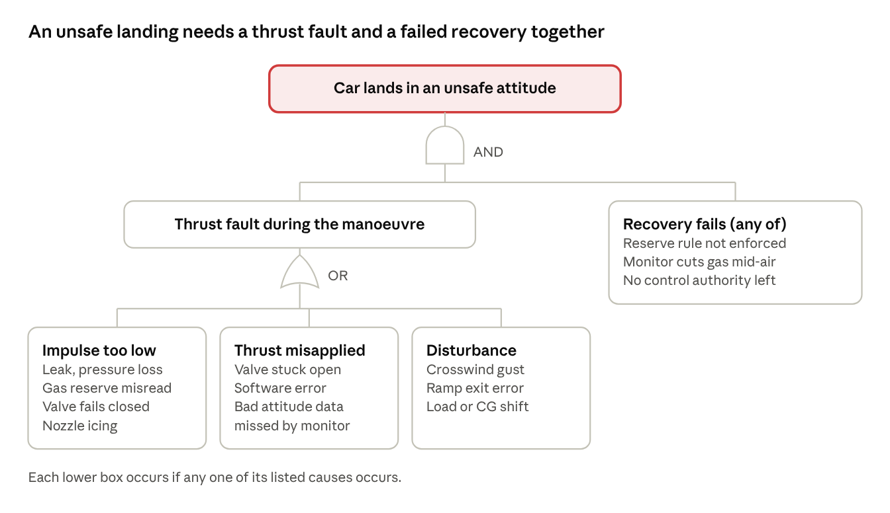

*Figure 5. Fault tree for an unsafe landing after a hop (SG6): a thrust fault (too little impulse, misapplied thrust or a disturbance) must combine with a failed recovery.*

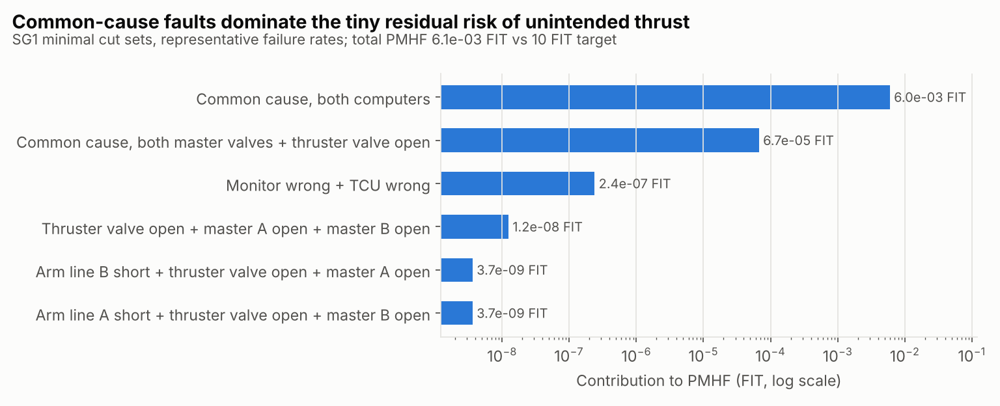

*Figure 6. The largest SG1 cut sets by rate. Common-cause failure of the two computers dominates; every independent combination is at least three orders of magnitude smaller.*

**How to read these numbers.** The metrics pass by a wide margin, but they rest on assumed failure rates and β-factors (1% for the computers and 2% for the master valves, A-14). The ranking matters more than the absolute values: the residual is dominated by common-cause faults, so the dependent failure analysis is the decisive evidence for SG1. An earlier, coarser FMEDA (Sim 6) gave PMHF 0.053 FIT; it is superseded by this component-level result.

## 8.4 Fault tree for SG6

An unsafe landing needs a thrust fault and a failed recovery together (Figure 5). That AND gate is the reason recovery logic matters so much. Per-hop probabilities from Sim 6, with 11 kN lift groups and a 99.9%-coverage pre-arm valve test, are:

| Branch | Probability per hop |
| --- | --- |
| Stuck-closed thruster valve, latent at take-off, during the roll | 1.8 × 10⁻⁷ |
| Leak | 1.4 × 10⁻⁷ |
| Stuck-open thruster valve | 1.4 × 10⁻⁸ |
| **Total from random hardware faults** | **3.3 × 10⁻⁷** (target 10⁻⁷, not yet met) |

Stuck-closed nozzles during the roll dominate. Meeting the target needs either individually controlled nozzles that keep at least 50% roll-braking authority (TSR-17) or a better recovery planner (TSR-20). Both show gaps in simulation today.

## 8.5 Dependent failure analysis

| Coupling factor | Could defeat | Measure | Residual |
| --- | --- | --- | --- |
| Same microcontroller design or compiler | Both computers | Dissimilar monitor, different supplier and tool chain (AD-02) | β about 1% |
| Same low-voltage supply | Both computers; both master valves | Separate feeds; monitor's own buffer; hold-up store (TSR-21) | Low |
| Same zone data | Both channels' arming decisions | Independent zone check in the monitor (CC-13, AD-09) | Low after CC-13 |
| Same valve type and batch | Both master valves | Different valve suppliers or seat designs; leak-down test (TSR-03) | β about 2% |
| Cold from gas expansion | Valves, seals, regulator | Cold qualification (TSR-18); dry air (TSR-19) | Needs test |
| Ice or contamination in the gas | All valves | Filter and dew-point check (TSR-19) | Low |
| Vessel burst fragments | Harness, both computers | Segregation, shielding and routing rules | Needs layout |
| Vibration and shock of landing | Connectors, sensors | Qualification to landing loads (Sim 5) | Needs test |
| Same software requirement error | Both channels | Different teams and requirements derived independently from FSRs | Process measure |
| Cyber attack on a shared input | Both channels | Isolated domain, authenticated bus (chapter 10) | See TARA |

## 8.6 STPA unsafe control actions

STPA covers hazards that need no failure: the controller does exactly what it was designed to do, but the decision is wrong for the situation.

| Control action | Not provided | Provided when unsafe | Wrong timing or order | Stopped too soon or applied too long |
| --- | --- | --- | --- | --- |
| Arm thrust | — | UCA-1: arming with a person in the clear zone (SG7) | UCA-2: arming before the pre-arm test finishes (SG1) | — |
| Open master valves | UCA-3: master valves not held open mid-hop (SG6) | UCA-4: open on a public road (SG1) | — | UCA-5: closed mid-hop by a supply dip (SG6) |
| Fire thrusters for a hop | — | UCA-6: hop with too little gas for recovery (SG6) | UCA-7: roll starts before climb rate settles (SG6) | UCA-8: thrust held after touchdown, car slides (SG7) |
| Command recovery | UCA-9: fault detected, no recovery commanded (SG6) | UCA-10: recovery on a false alarm wastes gas (SG6) | UCA-11: recovery after the FTTI has passed (SG6) | UCA-12: recovery ends before the car is level (SG6) |
| Cut all gas | — | UCA-13: cut while airborne (SG6) | — | — |
| Deploy external airbags | UCA-14: no deployment on a hard landing (SG8) | UCA-15: deployment on the road (SG8) | UCA-16: deployment too early, airbag vents before contact (SG8) | — |

Every unsafe control action maps to an existing requirement: UCA-1 to TSR-02; UCA-2 to TSR-16; UCA-3, UCA-5 and UCA-13 to TSR-12 and TSR-21; UCA-4 to TSR-01 and TSR-02; UCA-6 to TSR-10; UCA-7 to TSR-11 and TSR-20; UCA-8 to a landing-detection requirement to be added in the next issue (open issue OI-07); UCA-9 to UCA-12 to TSR-09, TSR-11, TSR-12 and TSR-20; UCA-14 to UCA-16 to TSR-14.

# 9. SOTIF analysis

ISO 21448 deals with hazards that arise when nothing is broken: the sensors, models or control laws are simply not good enough for the situation. For a hop these are the main risk, because the physics is unforgiving and the domain is new.

## 9.1 Triggering conditions

| ID | Triggering condition | Functional insufficiency | Possible hazard | Measure |
| --- | --- | --- | --- | --- |
| TC-01 | Gust above the planned limit during the roll | Control authority too low | Inverted landing | Wind limit in the operating domain (A-15); gust term in the reserve check |
| TC-02 | Gas colder than predicted after a fast refill | Reserve over-estimated | Gas runs out before landing | Temperature-corrected reserve (TSR-10) |
| TC-03 | Mass or centre of gravity outside the assumed range (luggage, passenger) | Controller tuned for wrong inertia | Roll overshoot | Seat and load sensing; refuse hop if out of range |
| TC-04 | Ground effect and jet reflection near the surface | Thrust model wrong below about 1 m | Bounce or tilt at take-off and landing | Ground-effect term; thrust-stand data |
| TC-05 | Loose gravel or debris | Jets throw debris; suction skirt lifts | Bystander injury; tilt | Surface check in the operating domain |
| TC-06 | Satellite multipath at the track | Position error | Arming outside the zone | Beacon plus inertial cross-check (CC-13) |
| TC-07 | Vibration or ice affects pressure sensing | Biased gas estimate | Wrong reserve decision | Dual dissimilar sensors (TSR-05) |
| TC-08 | Driver input during the hop | Mode confusion | Unexpected manoeuvre | Driver inputs ignored in Hop mode except abort |
| TC-09 | Nozzle thrust scatter above the 3% (1σ) modelled in Sim 4 | Allocation error | Drift and roll error | Closed-loop thrust estimation; thrust-stand calibration |
| TC-10 | Landing surface slope or step | Landing law assumes level ground | Roll on touchdown | Landing pad specification |

## 9.2 Known unsafe scenarios found so far

Sim 4 found no bad outcomes in 2,186 fault-free hops under random fill, temperature, mass, centre-of-gravity, gust and thrust scatter once the reserve check was in place. Without the reserve check, 21% of fault-free hops ran out of gas: that was the largest SOTIF finding of this study and led directly to TSR-10.

## 9.3 Acceptance criterion and validation target

| Item | Value |
| --- | --- |
| Acceptance criterion | Fewer than 10⁻⁷ catastrophic outcomes per hop from SOTIF causes, the same as for random hardware faults |
| Evidence today | Zero bad outcomes in 2,186 fault-free simulated hops gives an upper bound of 1.4 × 10⁻³ per hop at 95% confidence |
| Validation target | About 3 × 10⁷ hop-equivalents with no catastrophic outcome (zero-event rule: n ≥ 3 / 10⁻⁷) |
| How to get there | Mostly simulation with importance sampling of the triggering conditions above, anchored by about 10³ instrumented physical hops that validate the models |

## 9.4 Validation strategy

1. **Model validation.** Thrust-stand tests of each nozzle and of nozzle groups near the ground; tank blowdown tests at cold and hot fills; drop tests for the landing model.
2. **Scenario-based simulation.** A 6-degree-of-freedom model, validated in step 1, run over the triggering-condition space with importance sampling at the edges (gust in the roll, cold gas, mass offset).
3. **HIL.** The real thrust control unit and safety monitor in closed loop with the validated model.
4. **Tethered hops.** Physical hops on a crane tether with an empty cabin, then with ballast, then with a test pilot.
5. **Field monitoring.** Every hop logged; any recovery, refusal or limit exceedance reviewed.

# 10. Cybersecurity concept

A thrust system is a cybersecurity problem with physical consequences: a successful attack on it can fire jets on a public road. The analysis follows ISO/SAE 21434 and is designed to support a UN R155 type approval and a UN R156 software-update management system.

## 10.1 Assets

| ID | Asset | Property to protect |
| --- | --- | --- |
| A1 | Thrust commands and valve states | Integrity, availability in flight |
| A2 | Mode and arming state | Integrity |
| A3 | Zone authorisation (satellite fix, beacon) | Integrity, authenticity |
| A4 | Thrust-domain software and calibration | Integrity, authenticity |
| A5 | Cryptographic keys | Confidentiality, integrity |
| A6 | Gas state and fill commands | Integrity |
| A7 | Flight and location logs | Confidentiality |
| A8 | Update packages | Integrity, authenticity |
| A9 | Diagnostic and service access | Integrity, access control |

## 10.2 Security architecture

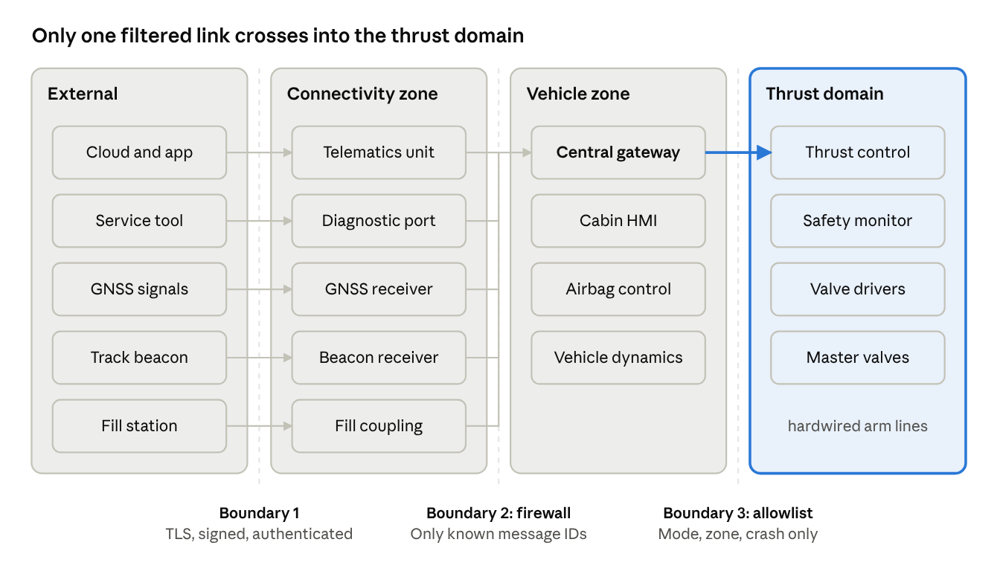

*Figure 7. Security zones: the thrust domain is isolated behind a zonal gateway that passes only three signal types; connectivity and infotainment have no path to it.*

## 10.3 Damage scenarios

| ID | Damage scenario | Impact | Linked safety goal |
| --- | --- | --- | --- |
| DS1 | Thrusters fire on a public road or near people | Severe | SG1 |
| DS2 | Loss of control during a hop | Severe | SG6 |
| DS3 | Thrust enabled outside an authorised zone | Severe | SG1, SG7 |
| DS4 | COPV over-pressure or rupture while filling | Severe | SG2 |
| DS5 | Fleet-wide unsafe or disabling software | Severe | SG1, SG6 |
| DS6 | Vehicle held to ransom; thrust unavailable | Major | - |
| DS7 | Owner removes safety limits | Severe | SG1, SG6, SG7 |
| DS8 | Location and flight logs exposed | Major | - |

## 10.4 Threat analysis and risk assessment

Attack feasibility uses the attack-potential method of ISO/SAE 21434 Annex G. Five factors are scored: elapsed time, specialist expertise, knowledge of the item, window of opportunity and equipment. A total of 0–13 points is High feasibility, 14–19 Medium, 20–24 Low and 25 or more Very low. Risk value (1–5) comes from impact and feasibility. Residual risk above 3 is not accepted, and the traceability check enforces this rule.

| ID | Threat scenario | Damage | Impact | Factors before | Feasibility before | Risk before | Controls | Factors after | Feasibility after | Risk after |
| --- | --- | --- | --- | --- | --- | --- | --- | --- | --- | --- |
| TS1 | Remote pivot from telematics to thrust command | DS1 | Severe | 4-6-3-0-4 = 17 | Medium | 4 | CC-01, CC-02 | 19-8-7-0-7 = 41 | Very low | 2 |
| TS2 | Diagnostic-port injection of mode and zone data | DS1, DS3 | Severe | 1-3-0-1-0 = 5 | High | 5 | CC-01, CC-03 | 4-6-3-4-4 = 21 | Low | 3 |
| TS3 | Satellite spoofing plus beacon replay | DS3 | Severe | 1-3-0-1-4 = 9 | High | 5 | CC-04, CC-05, CC-13 | 4-6-3-4-4 = 21 | Low | 3 |
| TS4 | Owner reflashes thrust software | DS7 | Severe | 1-3-0-0-4 = 8 | High | 5 | CC-06, CC-07 | 4-8-7-0-4 = 23 | Low | 3 |
| TS5 | Malicious or tampered software update | DS1, DS5 | Severe | 4-6-7-4-0 = 21 | Low | 3 | CC-06, CC-08 | 19-8-11-10-7 = 55 | Very low | 2 |
| TS6 | Spoofed fill station commands over-pressure | DS4 | Severe | 4-3-3-1-4 = 15 | Medium | 4 | CC-09 | 19-6-7-4-7 = 43 | Very low | 2 |
| TS7 | Bus jamming during a hop | DS2 | Severe | 0-3-0-4-0 = 7 | High | 5 | CC-02, CC-10 | 4-6-3-4-4 = 21 | Low | 3 |
| TS8 | Theft of flight logs from the cloud | DS8 | Major | 4-6-3-0-4 = 17 | Medium | 3 | CC-11 | 4-6-7-0-4 = 21 | Low | 2 |
| TS9 | Ransomware through infotainment | DS6 | Major | 4-6-3-0-4 = 17 | Medium | 3 | CC-01, CC-12 | 4-6-7-0-4 = 21 | Low | 2 |


*Figure 8. Attack tree for "thrusters fire on a public road". A faked track zone is the one path that defeats both channels at once, because both trust the same zone data; the independent zone check (CC-13) closes it.*

## 10.5 Cybersecurity goals

| ID | Cybersecurity goal | CAL | Threats |
| --- | --- | --- | --- |
| CG1 | No thrust command or mode change can enter the thrust domain from outside it | CAL 4 | TS1, TS2 |
| CG2 | Zone authorisation cannot be faked by spoofing or replay | CAL 4 | TS3 |
| CG3 | Only genuine, approved software runs in the thrust domain | CAL 4 | TS4, TS5 |
| CG4 | No external party can command a fill above the rated pressure | CAL 3 | TS6 |
| CG5 | Loss or jamming of thrust-domain communication never leads to loss of control | CAL 3 | TS7 |
| CG6 | Personal data and non-safety functions are protected and segregated | CAL 2 | TS8, TS9 |

## 10.6 Cybersecurity controls

| ID | Control | Goal | Verified by |
| --- | --- | --- | --- |
| CC-01 | Zonal gateway with allowlist: only mode request, zone data and crash signal reach the thrust domain | CG1, CG6 | VER-03 |
| CC-02 | Private thrust bus with message authentication, counters and timeouts | CG1, CG5 | VER-21 |
| CC-03 | Diagnostic access needs an authenticated service tool and empty tanks | CG1 | VER-21 |
| CC-04 | Signed challenge-response track beacon with distance bounding | CG2 | VER-25 |
| CC-05 | Positioning plausibility: satellite fix checked against wheel odometry and inertial data | CG2 | VER-25 |
| CC-06 | Secure boot with a hardware root of trust in both thrust computers | CG3 | VER-21 |
| CC-07 | Tamper detection forces Road-safe mode and logs the event | CG3 | VER-21 |
| CC-08 | Signed update packages, anti-rollback; thrust-domain updates only with tanks empty and the car present | CG3 | VER-21 |
| CC-09 | Authenticated fill coupling; independent mechanical pressure relief | CG4 | VER-18 |
| CC-10 | Communication loss in flight triggers the backup hop law (TSR-22) | CG5 | VER-23 |
| CC-11 | Log encryption, data minimisation and retention limits | CG6 | VER-21 |
| CC-12 | Domain segmentation: infotainment compromise cannot reach chassis or thrust | CG6 | VER-03 |
| CC-13 | Safety monitor confirms the zone independently by inertial dead-reckoning from the last trusted beacon fix | CG2 | VER-25 |

## 10.7 Operations and post-development

| Activity | Practice | Regulation |
| --- | --- | --- |
| Cybersecurity management system | Organisation-level processes, roles and audits | UN R155 |
| Software update management | Signed updates; thrust domain updated only with tanks empty and the car present; version records per vehicle | UN R156 |
| Vulnerability monitoring | Supplier bulletins, bug bounty, fleet security monitoring | ISO/SAE 21434 cl. 8 |
| Incident response | Fleet-wide remote lockout of thrust functions (to Road-safe only, never to enable) | ISO/SAE 21434 cl. 13 |
| End of cybersecurity support | Thrust functions disabled when support ends | ISO/SAE 21434 cl. 14 |

The remote lockout can only *disable* thrust. No remote command can enable it, which keeps the incident-response path from becoming an attack path.

# 11. Verification and validation plan

## 11.1 Strategy

Verification asks "did we build it right?" against each requirement. Validation asks "did we build the right thing?" against the safety goals and the acceptance criteria. Both follow the V-model, from analysis at concept stage to vehicle tests.

| Level | Methods | Main questions |
| --- | --- | --- |
| Concept | FMEA, FMEDA, FTA, DFA, STPA, TARA, simulation | Is the architecture capable of meeting the goals? |
| Component | Valve, sensor and vessel qualification; burst, cycle, cold and fire tests | Do parts meet their failure-rate and environmental assumptions? |
| Software | Requirements-based tests, MC/DC coverage for ASIL D parts, static analysis, fuzzing | Does the code do what the requirements say, and nothing else? |
| Integration (HIL) | Real computers in closed loop with a validated model; fault and attack injection | Do detection and reaction meet the timing budget? |
| Vehicle | Thrust stand, tethered hops, drop tests, crash tests with charged tanks, track tests | Does the whole car behave as predicted? |
| Validation | Scenario-based simulation at scale, field monitoring | Is residual risk below 10⁻⁷ per hop? |

## 11.2 Verification items

Every technical safety requirement and every cybersecurity control has at least one verification item, and every verification item lists what it covers. The table is generated from `data/verification.csv`.

| ID | Covers | Method | Pass criterion | Status |
| --- | --- | --- | --- | --- |
| VER-01 | TSR-01, TSR-03 | FMEDA; HIL fault injection; vehicle leak-down test | SPFM ≥ 99%, LFM ≥ 90%, PMHF < 10 FIT; no gas flow after any single fault | Analysis done |
| VER-02 | TSR-02 | HIL test of every combination of arming inputs | Arms only when all conditions hold | Not started |
| VER-03 | TSR-04, CC-01, CC-12 | Architecture review; penetration test | No external route to a thrust command | Not started |
| VER-04 | TSR-05 | HIL sensor-fault injection | Any single sensor fault detected | Not started |
| VER-05 | TSR-06 | Burst, cycling, fire, drop and impact tests | Burst ratio ≥ 2.25; all tests passed | Not started |
| VER-06 | TSR-07 | Valve timing bench; crash test with charged tanks | Valves closed ≤ 50 ms; no projectile; no net vent thrust | Not started |
| VER-07 | TSR-08 | Track test with controlled skirt leak; HIL | Limits applied ≤ 100 ms; car stays on line | Not started |
| VER-08 | TSR-09 | Sim 3; HIL timing measurement | ≤ 20 ms measured; FTTI ≥ 200 ms confirmed | Simulated |
| VER-09 | TSR-10 | Sim 4; track test with reduced fill | No gas-starved landing | Simulated |
| VER-10 | TSR-11 | Sim 4; HIL | Leak cases land safely | Simulated |
| VER-11 | TSR-12 | Sim 2; HIL | Upright landing after a mid-roll fault | Simulated |
| VER-12 | TSR-13 | HIL sensor-fault injection | Single IMU fault masked | Not started |
| VER-13 | TSR-14 | Sim 5; instrumented drop tests | Peak ≤ 15 g from 5 m; no deployment below 1.5 m or on road | Simulated |
| VER-14 | TSR-15 | Sim 3, Sim 4; thrust stand | Remaining lift ≥ 1.1 x weight | Simulated |
| VER-15 | TSR-16 | Diagnostic coverage analysis; HIL | Coverage ≥ 99.9% for stuck-open and stuck-closed | Analysis done |
| VER-16 | TSR-17 | Sim 4; design study | ≥ 50% roll-braking authority remains | Gap found |
| VER-17 | TSR-18 | Cold-soak and full-discharge tests of COPVs and valves | No leak, crack or sticking at minimum temperature | Not started |
| VER-18 | TSR-19, CC-09 | Fill-station test | Wet air refused | Not started |
| VER-19 | TSR-20 | Sim 3 sweep; HIL | No bad outcomes at delays ≤ 50 ms | Gap found |
| VER-20 | TSR-02 | Track test with dummy targets in the clear zone | Arming refused with a target in the zone | Not started |
| VER-21 | TSR-04, CC-02, CC-03, CC-06, CC-07, CC-08, CC-11 | Fuzzing, penetration test, code review (CG1-CG3) | No successful attack at CAL 4 depth | Not started |
| VER-22 | TSR-21 | HIL injection of power, coil, switch and computer loss in Hop mode | No master valve closes within 5 s of any single fault | Analysis done |
| VER-23 | TSR-22, CC-10 | HIL controller-loss injection; extended Sim 2 | Backup takes over ≤ 50 ms; upright landing ≤ 5 m/s | Analysis done |
| VER-24 | TSR-23 | HIL bus-loss injection | No valve opens unintentionally; attitude held | Analysis done |
| VER-25 | CC-04, CC-05, CC-13 | Spoofing and replay attack on a test track; HIL with simulated satellite and beacon signals | No arming with a spoofed fix or replayed beacon; monitor flags a zone mismatch within 1 s | Not started |

## 11.3 Test scenarios

| ID | Scenario | Fault or condition | Pass criterion | Covers |
| --- | --- | --- | --- | --- |
| SC-01 | Public-road drive with a forged arm request | Arm request injected on the vehicle bus | No master valve opens | TSR-01, TSR-02, TSR-04 |
| SC-02 | Power-on with a leaking master valve | Seat leak on valve A | Thrust locked out | TSR-03 |
| SC-03 | Stuck-open thruster at the apex | One nozzle forced open | Line isolated ≤ 20 ms; upright landing | TSR-09, TSR-15 |
| SC-04 | Stuck-closed nozzle during the roll | One nozzle forced closed at 1.3 s | Upright landing at ≤ 5 m/s | TSR-17, TSR-20 |
| SC-05 | Leak from one vessel group mid-climb | 5 kg/s leak | Recovery starts at once; upright landing | TSR-10, TSR-11 |
| SC-06 | Thrust control unit reset mid-hop | Controller power removed | Backup law takes over ≤ 50 ms | TSR-22 |
| SC-07 | Supply dip mid-hop | Low-voltage feed drops for 200 ms | No master valve closes | TSR-21 |
| SC-08 | Valve bus lost mid-hop | Bus disconnected | No valve opens unintentionally; attitude held | TSR-23 |
| SC-09 | Crash with charged tanks | Frontal crash test | Vessels isolated ≤ 50 ms; no projectile; no net vent thrust | TSR-06, TSR-07 |
| SC-10 | Satellite spoofing at the track gate | Fake fix inside the zone | Arming refused; monitor flags mismatch | CC-04, CC-05, CC-13 |
| SC-11 | Hard landing from 5 m | Drop test with external airbag | Peak ≤ 15 g | TSR-14 |
| SC-12 | Cold refill then immediate hop | Gas 20 K colder than nominal | Reserve check corrects for temperature | TSR-10, TSR-18 |

## 11.4 Simulation credibility

The simulations in this study are concept-stage evidence. Before they can support a release decision they need the following.

| Credibility factor | Status today | Needed |
| --- | --- | --- |
| Model fidelity | Planar roll-plane rigid body; lumped tank | 6-degree-of-freedom model with nozzle plume and ground effect |
| Parameter basis | Assumptions A-01 to A-16 | Measured mass properties, thrust-stand and blowdown data |
| Code verification | Energy and momentum checks; deterministic seeds | Independent review; unit tests against analytic cases |
| Validation | None against hardware | Correlation with tethered hops within agreed tolerances |
| Tool qualification | Open-source Python | Tool confidence level assessed per ISO 26262-8 cl. 11 |

## 11.5 Roadmap

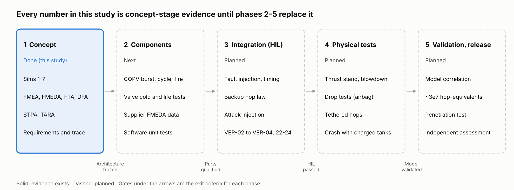

*Figure 9. Verification and validation roadmap from this concept study (Sims 1–7) to release.*

## 11.6 Evidence status

Of 25 verification items, 5 have analysis evidence, 6 have simulation evidence, 2 show a gap that needs design work (VER-16, VER-19) and 12 have not started. No physical test evidence exists.

# 12. Traceability

Traceability proves that every hazard is covered by a goal, every goal by requirements, every requirement by an architecture element and a test, and every test by a requirement. Two chains are traced.

- **Safety:** hazardous event → safety goal → functional safety requirement → technical safety requirement → architecture element → verification item → evidence.
- **Security:** damage scenario → threat scenario → cybersecurity goal → control → verification item.

All links live in one place, the requirements database (`tools/requirements_db.py`, written out to `data/*.csv`). The tables in this document are generated from it, so the document and the data cannot drift apart. `tools/check_traceability.py` checks every link in both directions and fails the build if any link is broken.

## 12.1 Safety trace matrix

| TSR | Hazards | Goals | FSR | Elements | Verification | Status |
| --- | --- | --- | --- | --- | --- | --- |
| TSR-01 | HE1, HE2 | SG1 | FSR-1.1 | S4, S9, IF-01, IF-02 | VER-01 | Analysis done |
| TSR-02 | HE1, HE2, HE9 | SG1, SG7 | FSR-1.2, FSR-7.1 | S8, S9, S10, IF-05, IF-09 | VER-02, VER-20 | Not started |
| TSR-03 | HE1, HE2 | SG1 | FSR-1.1 | S4, S8, S9 | VER-01 | Analysis done |
| TSR-04 | HE1, HE2 | SG1 | FSR-1.3 | S9, IF-03 | VER-03, VER-21 | Not started |
| TSR-05 | HE3, HE7, HE8, HE11 | SG2, SG6 | FSR-6.4, FSR-2.1 | S3, S8, IF-07 | VER-04 | Not started |
| TSR-06 | HE3 | SG2 | FSR-2.1 | S3 | VER-05 | Not started |
| TSR-07 | HE3 | SG2 | FSR-2.2 | S3, S4, S11, IF-10 | VER-06 | Not started |
| TSR-08 | HE5 | SG4 | FSR-4.1 | S6, S7, IF-08 | VER-07 | Not started |
| TSR-09 | HE6, HE7, HE8, HE11 | SG5, SG6 | FSR-5.1, FSR-6.3 | S4, S5, S9, IF-11 | VER-08 | Simulated |
| TSR-10 | HE7, HE8, HE11 | SG6 | FSR-6.1 | S3, S9 | VER-09 | Simulated |
| TSR-11 | HE7, HE8, HE11 | SG6 | FSR-6.2 | S9 | VER-10 | Simulated |
| TSR-12 | HE7, HE8, HE11 | SG6 | FSR-6.2 | S9 | VER-11 | Simulated |
| TSR-13 | HE7, HE8, HE11 | SG6 | FSR-6.4 | S8, IF-06 | VER-12 | Not started |
| TSR-14 | HE10 | SG8 | FSR-8.1 | S11 | VER-13 | Simulated |
| TSR-15 | HE7, HE8, HE11 | SG6 | FSR-6.3 | S5 | VER-14 | Simulated |
| TSR-16 | HE1, HE2, HE7, HE8, HE11 | SG1, SG6 | FSR-1.1, FSR-6.3 | S4, S5, S9 | VER-15 | Analysis done |
| TSR-17 | HE7, HE8, HE11 | SG6 | FSR-6.3 | S5, S9 | VER-16 | Gap found |
| TSR-18 | HE3 | SG2 | FSR-2.1 | S3, S4, S5 | VER-17 | Not started |
| TSR-19 | HE3 | SG2 | FSR-2.1 | S2 | VER-18 | Not started |
| TSR-20 | HE7, HE8, HE11 | SG6 | FSR-6.2 | S9 | VER-19 | Gap found |
| TSR-21 | HE7, HE8, HE11 | SG6 | FSR-6.2 | S1, S4, S9 | VER-22 | Analysis done |
| TSR-22 | HE7, HE8, HE11 | SG6 | FSR-6.2 | S9 | VER-23 | Analysis done |
| TSR-23 | HE7, HE8, HE11 | SG6 | FSR-6.2 | S9, IF-03, IF-11 | VER-24 | Analysis done |

## 12.2 Security trace matrix

| Damage | Threat | Goal | Controls | Verification | Risk |
| --- | --- | --- | --- | --- | --- |
| DS1 | TS1 | CG1 (CAL 4) | CC-01, CC-02 | VER-03, VER-21 | 4 → 2 |
| DS1, DS3 | TS2 | CG1 (CAL 4) | CC-01, CC-03 | VER-03, VER-21 | 5 → 3 |
| DS3 | TS3 | CG2 (CAL 4) | CC-04, CC-05, CC-13 | VER-25 | 5 → 3 |
| DS7 | TS4 | CG3 (CAL 4) | CC-06, CC-07 | VER-21 | 5 → 3 |
| DS1, DS5 | TS5 | CG3 (CAL 4) | CC-06, CC-08 | VER-21 | 3 → 2 |
| DS4 | TS6 | CG4 (CAL 3) | CC-09 | VER-18 | 4 → 2 |
| DS2 | TS7 | CG5 (CAL 3) | CC-02, CC-10 | VER-21, VER-23 | 5 → 3 |
| DS8 | TS8 | CG6 (CAL 2) | CC-11 | VER-21 | 3 → 2 |
| DS6 | TS9 | CG6 (CAL 2) | CC-01, CC-12 | VER-03 | 3 → 2 |

## 12.3 Automated check

The output below was produced by the build that made this document.

```
hazards 11, goals 8, FSR 14, TSR 23, elements 22, verification items 25
damage scenarios 8, threats 9, cybersecurity goals 6, controls 13
verification status: Analysis done 5, Gap found 2, Not started 12, Simulated 6
out of scope: FSR-3.1
traceability check passed: every link resolves
```

**Rules the check enforces.**

1. Every hazardous event names a safety goal that exists, and every safety goal has at least one hazardous event.
2. Every safety goal has at least one functional safety requirement.
3. Every functional safety requirement is refined by a technical safety requirement, or is explicitly allocated to another item (FSR-3.1, steering).
4. Every technical safety requirement is allocated to an architecture element that exists, and names a verification item that exists and lists it back.
5. Every threat scenario names damage scenarios, a cybersecurity goal and controls that exist, and has residual risk 3 or below.
6. Every cybersecurity goal has a threat and a control; every control treats a threat and names a verification item that lists it back.
7. Every verification item covers only requirements or controls that exist.

# 13. Safety case, regulation, review record and open issues

## 13.1 Safety case structure

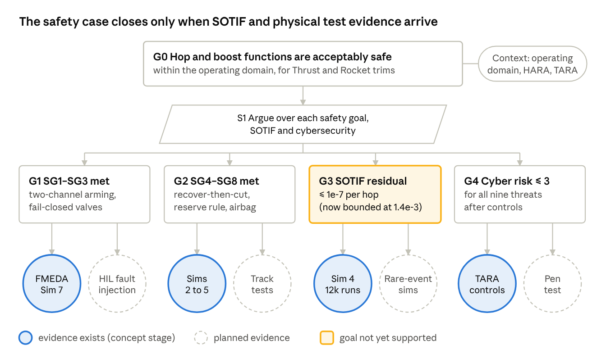

*Figure 10. Safety case in goal structuring notation. The top claim (G0) is that the hop and boost functions are acceptably safe within the operating domain. Strategy S1 argues over each safety goal, SOTIF and cybersecurity.*

| Claim | Status | Evidence today | Evidence still needed |
| --- | --- | --- | --- |
| G1 SG1–SG3 are met | Supported at concept stage | FMEDA and cut sets (Sim 7): SPFM 100%, LFM 98.7%, PMHF 0.006 FIT | HIL fault injection; DFA with test data; steering item's own case (SG3) |
| G2 SG4–SG8 are met | Partly supported | Sims 2–5: recover-then-cut, reserve check, airbag loads | SG6 per-hop risk 3.3 × 10⁻⁷ against a 10⁻⁷ target; track tests |
| G3 SOTIF residual risk is at most 10⁻⁷ per hop | Not supported | Sim 4 bounds it at 1.4 × 10⁻³ per hop | Validated model and rare-event simulation campaign |
| G4 Residual cyber risk is 3 or below | Supported at concept stage | TARA with 13 controls | Penetration tests (VER-21, VER-25) |

## 13.2 Regulatory pathway

No regulation today covers a road car that fires thrusters or leaves the ground. The likely path is to keep the two worlds separate.

| Domain | Situation | Likely route |
| --- | --- | --- |
| Road type approval (US FMVSS, EU, UN) | No standard addresses thrusters, stored compressed air for propulsion or external airbags | Road-legal trims with thrust physically disabled in Road-safe mode; Rocket trim sold as not approved for public road use, as Tesla already states [B9] |
| Pressure vessels | Compressed-air propulsion vessels on cars have no dedicated rule | Qualify to the closest standards: UN GTR 13 and UN R134 (hydrogen vessels), UN R110 (CNG) and ISO 11119-3 (composite cylinders) |
| Aviation (FAA, EASA) | Whether a few-second hop counts as flight is unresolved | Operate only at closed sites under event or test permissions; seek early regulator engagement |
| Cybersecurity and updates | UN R155 and R156 apply to type-approved vehicles | Apply both to all trims |
| Track use | Track operators set their own rules | Site procedures, clear zones and marshals, written into the operating domain |

## 13.3 Independent review record

This issue was reviewed against the earlier issues and the public sources. Each finding below has been closed in this document.

| ID | Finding | Correction | Where |
| --- | --- | --- | --- |
| RV-01 | Fill pressure of 600 bar mixed up the 600 L volume with pressure | 400 bar adopted, consistent with the 250 kg gas figure | Ch. 5, A-05 |
| RV-02 | Burst energy over-stated at 90 MJ | Recalculated: about 60 MJ (about 14 kg TNT) | Ch. 5 |
| RV-03 | Launch gas use over-stated at 57–84 kg | Recalculated: 32–46 kg (0.9 s) and 46–67 kg (0.59 s) | Ch. 5 |
| RV-04 | Normally closed valves drop the car if power or a computer is lost mid-hop | TSR-21 to TSR-23 added; E/E architecture updated | Ch. 4, 7, 8 |
| RV-05 | Both channels trusted the same zone data, a common-mode attack path | Independent zone confirmation CC-13 and AD-09 added | Ch. 4, 10 |
| RV-06 | ASIL B for SG6 looked too low for a flight-like manoeuvre | Rationale written; FHA target 10⁻⁷ per hop added as a quantitative requirement | Ch. 6 |
| RV-07 | Coarse FMEDA (Sim 6) not at component level | Superseded by component-level cut-set FMEDA (Sim 7) | Ch. 8 |
| RV-08 | First PMHF result was implausibly small because common-cause faults were missing | β-factor common-cause events added | Ch. 8, A-14 |
| RV-09 | "SpaceX-built" overstated the sources | Changed to "developed with SpaceX" | Ch. 1, 2 |
| RV-10 | Single-source facts presented as confirmed | Each fact tagged with its source; unconfirmed items marked | Ch. 2, App. B |
| RV-11 | Requirements, trace and tables kept in several places could drift | One requirements database; document tables generated from it; automated two-way link check | Ch. 12 |

## 13.4 Open issues

| ID | Issue | Owner action | Blocks |
| --- | --- | --- | --- |
| OI-01 | SG6 per-hop risk 3.3 × 10⁻⁷ is above the 10⁻⁷ target | Individually controlled nozzles (TSR-17), better recovery planner (TSR-20) | Release |
| OI-02 | SOTIF residual risk not demonstrated | Validated 6-degree-of-freedom model and scenario campaign (ch. 9) | Release |
| OI-03 | Stuck-closed nozzle during the roll fails about one case in three | Design study for nozzle layout and roll authority | Release |
| OI-04 | Failure rates and β-factors are assumed | Supplier FMEDA data; DFA with test data | Safety case G1 |
| OI-05 | Cold-gas effects on valves and seals unknown | Full-discharge cold tests | Safety case G1 |
| OI-06 | Regulatory classification of a hop | Early engagement with road and aviation regulators | Market entry |
| OI-07 | No requirement stops thrust after touchdown (UCA-8) | Add a landing-detection requirement in the next issue | Next issue |
| OI-08 | A fall from 6 m gives 16.5 g even with external airbags, above the 15 g criterion; the operating domain allows a 6 m apex | Cut the apex limit to 5 m (14 g) or improve the landing system | Operating domain |

# 14. Simulation report

Seven simulations support the analysis. They are deliberately simple, so anyone can read, run and challenge them: about 1,400 lines of Python using NumPy and Matplotlib, all in `sim/`. `python sim/run_all.py` reproduces every number and chart in this chapter in under two minutes on a laptop. Random seeds are fixed, so results are repeatable.

## 14.1 Common model

| Element | Model |
| --- | --- |
| Vehicle | Planar rigid body in the roll plane: height, lateral position and roll angle, 1,850 kg, 600 kg·m² (A-01, A-02) |
| Thrusters | Four lift groups of 9 kN at ±0.35 m and ±0.85 m from the centreline (A-06); first-order valve lag; ±3% thrust scatter |
| Gas | Adiabatic blowdown of a lumped tank with real-gas density, regulated 40 bar feed, specific impulse falling with gas temperature (A-05, A-07, A-08) |
| Guidance | Reference hop: climb to 4.5 m in 1.3 s, 360° roll near the apex, descent at up to 4 m/s slowing to 0.8 m/s near the ground |
| Control | PD attitude and height control with feed-forward; torque-first allocation to the available groups (A-10) |
| Faults | Stuck-open, stuck-closed or leaking group at any time; detection delay as a parameter |
| Monitor strategies | None; cut all gas; isolate the faulty group and recover |
| Outcome | Safe if the car lands with roll below 30° and vertical speed below 5 m/s |

## 14.2 Sim 1: gas budget

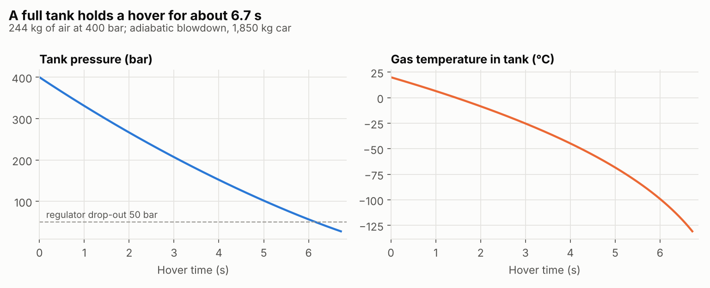

*Figure 11. Tank pressure, gas temperature and usable thrust during a full-tank hover.*

A full bank of 244 kg at 400 bar holds the car in a hover for 6.7 s. Pressure falls to 28 bar and gas temperature to 142 K. Specific impulse falls from 69 s to 48 s as the gas cools. The reference hop needs 134 kg (55% of the fill). Stored burst energy is 60 MJ, about 14 kg of TNT.

## 14.3 Sim 2: stuck-open valve, three monitor strategies

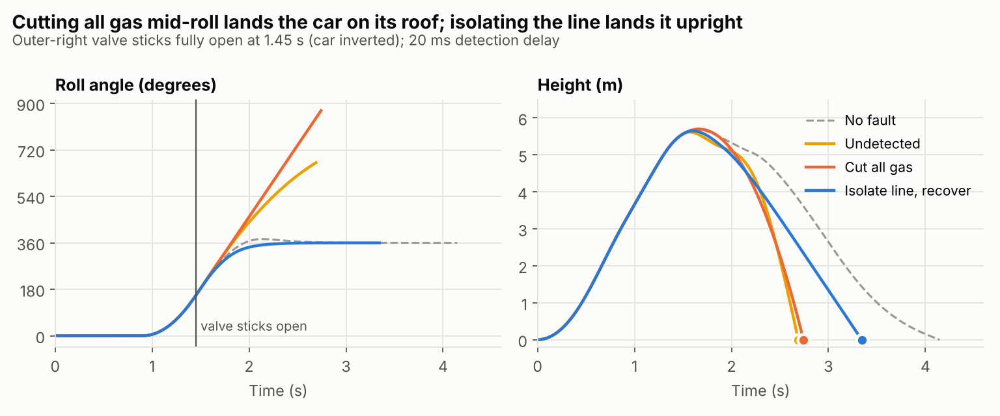

*Figure 12. Roll angle and height after an outer lift group sticks open at 1.45 s, when the car is nearly inverted.*

| Strategy | Touchdown | Roll at touchdown | Vertical speed | Outcome |
| --- | --- | --- | --- | --- |
| No fault | 4.15 s | 0° | 1.0 m/s | Safe |
| Fault not detected | 2.69 s | −49° | 11.8 m/s | Unsafe |
| Cut all gas | 2.74 s | 152° (on the roof) | 10.6 m/s | Unsafe |
| Isolate the line and recover | 3.34 s | 0° | 3.9 m/s | Safe |

Cutting all gas, the classic "safe state", lands the car on its roof. This single result drives AD-03 and TSR-12.

## 14.4 Sim 3: fault tolerant time interval


*Figure 13. Share of bad outcomes against detection-plus-isolation delay, over fault times from 0.6 s to 3.0 s.*

| Lift group | Bad at 20 ms | Bad at 100 ms | Bad at 300 ms | Delay where bad outcomes pass 10% |
| --- | --- | --- | --- | --- |
| 9 kN | 4.1% | 2.0% | 20.4% | 200 ms |
| 11 kN | 2.0% | 0% | 0% | 440 ms |

The FTTI is about 200 ms with 9 kN groups, so a 20 ms budget leaves a tenfold margin. The residual bad outcomes at short delays come from faults in the middle of the roll, where the recovery planner sometimes chooses the longer way back to level. That is the gap recorded against TSR-20. Larger 11 kN groups remove almost all stuck-open failures.

## 14.5 Sim 4: Monte Carlo over 12,000 hops

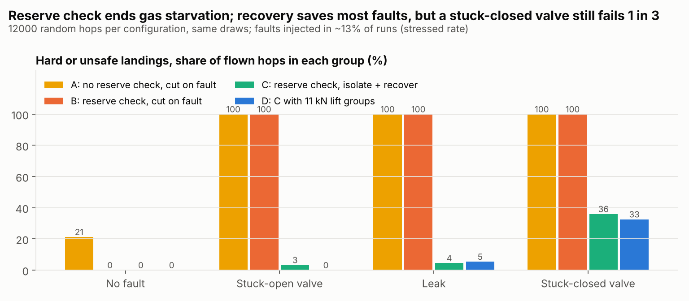

*Figure 14. Bad-outcome rates for four architecture options over the same 12,000 random draws.*

Each draw varies fill (40–100%), gas temperature, mass, inertia, centre of gravity, gusts and thrust scatter, and injects a stuck-open, leak or stuck-closed fault at an elevated rate so that each fault type gets enough samples.

| Option | Hops refused | Bad per flown hop | Bad, no fault | Bad given stuck open | Bad given leak | Bad given stuck closed |
| --- | --- | --- | --- | --- | --- | --- |
| A: no reserve check, cut on fault | 0% | 31.6% | 21.2% | 100% | 100% | 100% |
| B: reserve check, cut on fault | 79.1% | 12.7% | 0% | 100% | 100% | 100% |
| C: reserve check, isolate and recover | 79.1% | 1.6% | 0% | 3.3% | 4.5% | 36.0% |
| D: C with 11 kN lift groups | 79.1% | 1.4% | 0% | 0% | 5.4% | 32.6% |

The high refusal rate reflects the deliberately wide fill range: the reference hop needs at least 86% fill. In service the reserve check would offer a lower manoeuvre instead of refusing (AD-08). The two key results are that the reserve check removes gas starvation and that isolating and recovering saves almost every stuck-open and leak case. The stuck-closed result of about one in three is the main open design issue (OI-03).

## 14.6 Sim 5: landing loads

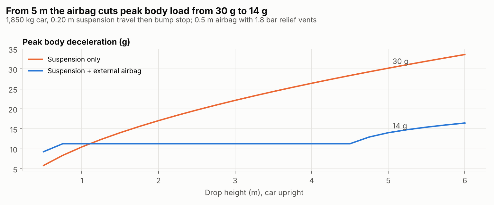

*Figure 15. Peak deceleration against drop height, suspension alone and with an external airbag.*

| Drop height | Suspension only, peak | With airbag, peak |
| --- | --- | --- |
| 2 m | 17.1 g | 11.3 g |
| 4 m | 26.4 g | 11.3 g |
| 5 m | 30.2 g | 14.0 g |
| 6 m | 33.6 g | 16.5 g |

The airbag's relief vents hold its pressure at 1.8 bar, which caps the peak at about 11 g up to 4 m. Above about 4 m the airbag reaches the end of its stroke and loads rise again. That supports a 5 m limit on apex height (OI-08).

## 14.7 Sim 6: per-hop risk (first FMEDA superseded)

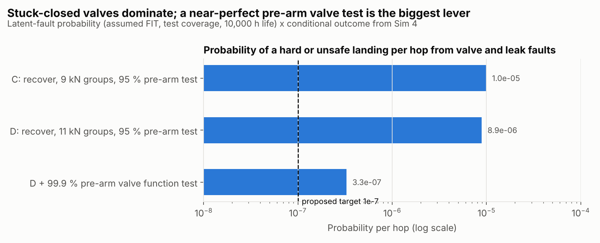

*Figure 16. Per-hop probability of a bad landing from random faults, for three design options, against the 10⁻⁷ target.*

Combining Sim 4's conditional outcomes with fault rates and pre-arm test coverage gives the per-hop risk of a bad landing. With 11 kN groups and a 99.9%-coverage pre-arm valve test it is 3.3 × 10⁻⁷, still above the 10⁻⁷ target; stuck-closed faults dominate. Sim 6 also contains a first, coarse FMEDA, which Sim 7 supersedes.

## 14.8 Sim 7: component FMEA and cut-set FMEDA

Sim 7 holds the component DFMEA (31 failure modes, chapter 8.2) and solves the SG1 fault tree for its 36 minimal cut sets. It gives SPFM 100%, LFM 98.7% and PMHF 0.006 FIT, with the computers' common-cause term dominating (Figure 6).

## 14.9 Limits of the models

- Planar model: no pitch or yaw coupling, no lateral wind profile, no plume or ground-effect modelling.
- Lumped tank: no temperature gradients, no heat transfer from vessel walls (this makes the gas colder than reality, a conservative assumption for thrust and a non-conservative one for valve icing).
- Ideal valves with first-order lag; no valve chatter or water hammer.
- Failure rates, coverages and β-factors are assumed (A-11, A-12, A-14).
- No model has been validated against hardware. The results show *relative* merits of architecture options; absolute values need test data.

## 14.10 Interactive viewer

`viewer/index.html` replays the simulated trajectories in a browser with no installation. It plays 14 precomputed scenarios (the no-fault hop, stuck-open valves with each monitor strategy and several detection delays, stuck-closed valves, leaks, gas starvation and a crosswind gust) and a scan of stuck-closed fault timing that shows the 1.10–1.95 s danger window. A hosted version is the "Roadster Hop Fault Lab".

# Appendix A. Assumptions register

Tesla has not published the design. Every number in this study that is not a disclosed fact (chapter 2) rests on one of the assumptions below. Each has a basis and states what real data would replace it. Changing an assumption and running `python sim/run_all.py` and `python tools/build_docs.py` regenerates every affected result.

| ID | Parameter | Value | Basis | Replace with |
| --- | --- | --- | --- | --- |
| A-01 | Vehicle mass | 1,850 kg | '4,000+ lb' quoted at the reveal (TechCrunch) | Weighbridge data |
| A-02 | Roll inertia | 600 kg m2 | Typical low sports car | Inertia rig measurement |
| A-03 | Gas storage volume | 600 L | Disclosed by Tesla (L. Moravy) | - |
| A-04 | Gas mass | 250 kg reported; 244 kg modelled | InsideEVs, single source | Tesla specification |
| A-05 | Fill pressure | 400 bar | Derived: 250 kg in 600 L at 20 C with Z = 1.17 | COPV rating |
| A-06 | Thruster count and layout | 10 nozzles; four lift groups of 9 kN at +/-0.35 and +/-0.85 m | Count disclosed; layout assumed | Nozzle layout and thrust-stand data |
| A-07 | Thrust coefficient | 1.35 | Typical cold-gas nozzle with losses | Thrust stand |
| A-08 | Regulation | 40 bar feed; full thrust lost below 50 bar tank | Assumed | Regulator characterisation |
| A-09 | Number of COPVs | 6 vessels in 3 groups | 'Every usable void' implies many vessels | Design data |
| A-10 | Control law | PD with feed-forward, torque-first allocation | Assumed | Production control laws |
| A-11 | Component failure rates | 10-300 FIT per part (see component FMEA) | Representative magnitudes | Supplier FMEDA data |
| A-12 | Diagnostic coverage | 90-99%; pre-arm test 95% or 99.9% | Assumed | Diagnostic coverage analysis |
| A-13 | Vehicle operating life | 10,000 h | Typical automotive mission profile | Programme mission profile |
| A-14 | Common-cause shares | beta = 1% (computers), 2% (master valves) | Typical beta-factor range for diverse redundancy | Dependent failure analysis with test data |
| A-15 | Operating domain limits | Wind < 8 m/s (gusts < 12), -10 to +40 C, dry paved surface | Proposed by this study | Validated limits |
| A-16 | Landing system | Suspension 140 kN/m, 0.20 m travel; airbag 2.6 m2, 0.5 m stroke, 1.8 bar relief | Assumed | Drop tests |

# Appendix B. Sources

Public sources for the facts in chapter 2, checked between 15 and 18 October 2026. Facts reported by only one outlet are marked.

| Ref | Source | Used for |
| --- | --- | --- |
| [B1] | [TechCrunch: Tesla reveals SpaceX-powered Roadster that flies and falls with style](https://techcrunch.com/2026/10/15/tesla-reveals-spacex-powered-roadster-that-flies-and-falls-with-style/) | 600 L of compressed air, 10 thrusters, COPVs, remote-operated demonstration, 2028 production |
| [B2] | [The EV Report: Tesla Unveils Production Roadster With SpaceX Cold-Gas Thrusters](https://theevreport.com/tesla-roadster-unveil-spacex-cold-gas-thrusters) | Trims, suction system, electric actuators, not approved for public roads |
| [B3] | [InsideEVs: Tesla Just Revealed The Roadster](https://insideevs.com/news/812151/2027-tesla-roadster-price-specs-release-date/) | 250 kg of gas, 2G cornering (single source; page unavailable when last checked) |
| [B4] | [Eletric-Vehicles.com: Tesla Unveils Thruster-Equipped Roadster](https://eletric-vehicles.com/tesla/tesla-unveils-thruster-equipped-roadster-sets-production-for-2028/) | Acceleration figures, production date |
| [B5] | [Swisher Post: Tesla Roadster unveiled](https://www.swisherpost.com/technology/tesla-roadster-unveiled-thrusters-flips-price-production-date/) | Acceleration figures, price |
| [B6] | [Benzinga via Webull: Tesla Preps SpaceX Rocket-Powered Flying Roadster Demo](https://www.webull.ca/news-detail/15402037474960384) | A71 code name (unconfirmed) |
| [B7] | [Tesorb: pre-reveal report on the A71 system](https://tesorb.com/?p=3628) | Pressure range (unconfirmed) |
| [B8] | [Electrek: Musk says Roadster's SpaceX package will include rocket thrusters (2018)](https://electrek.co/2018/06/09/elon-musk-tesla-next-gen-roadster-spacex-package-rocket-thrusters/) | 2018 SpaceX package, about 10 thrusters |
| [B9] | [Gagadget: Tesla Roadster Gets an October 1 Reveal](https://gagadget.com/en/725987-tesla-roadster-gets-an-october-1-reveal-musk-wants-witnesses/) | Regulatory status |

## Standards referenced

ISO 26262:2018 (road vehicles, functional safety), ISO 21448:2022 (SOTIF), ISO/SAE 21434:2021 (cybersecurity engineering), UN Regulations No. 155 and 156, UN GTR No. 13, UN Regulations No. 110 and 134, ISO 11119-3, SAE ARP4761A and ARP4754B, AIAG-VDA FMEA Handbook (2019), STPA Handbook (Leveson and Thomas, 2018), GSN Community Standard v3.
